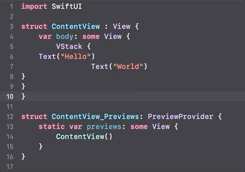

+++
title =  "Xcodeでコードをフォーマットする"
url = "2020-08-07"
date = "2020-08-07"
description = "Xcodeでコードをフォーマットする"
tags = ["Xcode"]
categories = ["Xcode"]
archives = "2020/08"
+++

 

Xcodeでコードをフォーマットする方法です。
command + a でコードを全て選択し、control + i でコードをフォーマットすることができます。

<!-- Google Ads -->


<!-- Amazon Ads -->

