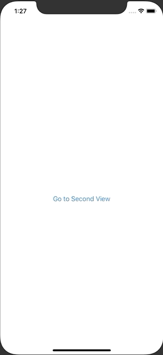

+++
title =  "SwiftUIでプログラムで前の画面に戻る"
url = "2020-09-01"
date = "2020-09-01"
description = "SwiftUIでプログラムで前の画面に戻る"
tags = ["iOS", "Swift", "SwiftUI"]
categories = ["iOS", "Swift"]
archives = "2020/09"
+++

<br>

SwiftUI でプログラムで前の画面に戻る方法です。
NavigationView と NavigationLink を使うと画面遷移することができます。
戻るボタンは自動で付与されますが、戻るボタン意外の方法で前の画面に戻りたいときは、PresentationMode を使うことで実現できます。



<!-- Google Ads -->


<!-- Amazon Ads -->


<!--more-->

**ContentView.swift**

```swift
import SwiftUI

struct ContentView: View {
    var body: some View {
        NavigationView {
            NavigationLink(destination: SecondView()) {
                Text("Go to Second View")
            }
        }
    }
}

struct SecondView: View {
    @Environment(\.presentationMode) var presentationMode: Binding<PresentationMode>
    var body: some View {
        Button(action: {
            self.presentationMode.wrappedValue.dismiss()
        }) {
            Text("Back to FirstView")
        }
    }
}

struct ContentView_Previews: PreviewProvider {
    static var previews: some View {
        ContentView()
    }
}
```

