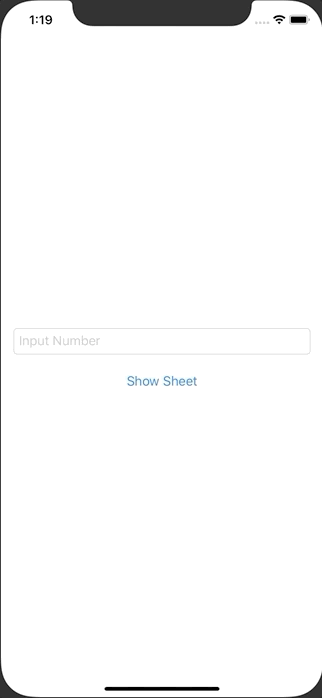

+++
title =  "SwiftUIでアラートとシートを出し分ける"
url = "2020-09-03"
date = "2020-09-03"
description = "SwiftUIでアラートとシートを出し分ける"
tags = ["iOS", "Swift", "SwiftUI"]
categories = ["iOS", "SwiftUI"]
archives = "2020/09"
+++

<br>

SwiftUIでアラートとシートを出し分ける方法です。
TextField に入力された文字列が Double に変換できるかチェックします。
もし Double に変換できるのであればシートを表示し、もし Double に変換できないのであればアラートを表示します。



<!-- Google Ads -->


<!-- Amazon Ads -->


<!--more-->

**ContentView.swift**

```swift
import SwiftUI

struct ContentView: View {
    @State var numberString: String = ""
    @State var showingAlert: Bool = false
    @State var showingSheet: Bool = false
    
    var body: some View {
        VStack {
            TextField("Input Number", text: $numberString)
                .padding()
                .textFieldStyle(RoundedBorderTextFieldStyle())
            
            Button(action: {
                // Can numberString convert to Double?
                guard Double(self.numberString) != nil else {
                    self.showingAlert = true
                    return
                }
                self.showingSheet = true
            }) {
                Text("Show Sheet")
            }
        }
        .alert(isPresented: $showingAlert) {
            Alert(title: Text("Error"), message: Text("Please Input Number"), dismissButton: .default(Text("Close")))
        }
        .sheet(isPresented: $showingSheet) {
            Text("\(self.numberString) can convert to Double")
        }
    }
}

struct ContentView_Previews: PreviewProvider {
    static var previews: some View {
        ContentView()
    }
}
```

