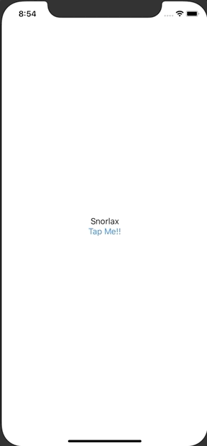

+++
title =  "Buttonを押すとTextの文字が変わる"
url = "2020-09-04"
date = "2020-09-04"
description = "Buttonを押すとTextの文字が変わる"
tags = ["iOS", "Swift", "SwiftUI"]
categories = ["iOS", "SwiftUI"]
archives = "2020/09"
+++

<br>

SwiftUIでButtonが押されたら文字の色を変える方法です。
ボタンが押されたタイミングで <code>@State var text</code> を更新します。



<!-- Google Ads -->


<!-- Amazon Ads -->


<!--more-->

**ContentView.swift**

```swift
import SwiftUI

struct ContentView: View {
    @State var text = "Snorlax"
    
    var body: some View {
        VStack {
            Text(text)
            Button(action: {
                self.text = "Forever"
            }) {
                Text("Tap Me!!")
            }
        }
    }
}

struct ContentView_Previews: PreviewProvider {
    static var previews: some View {
        ContentView()
    }
}
```

