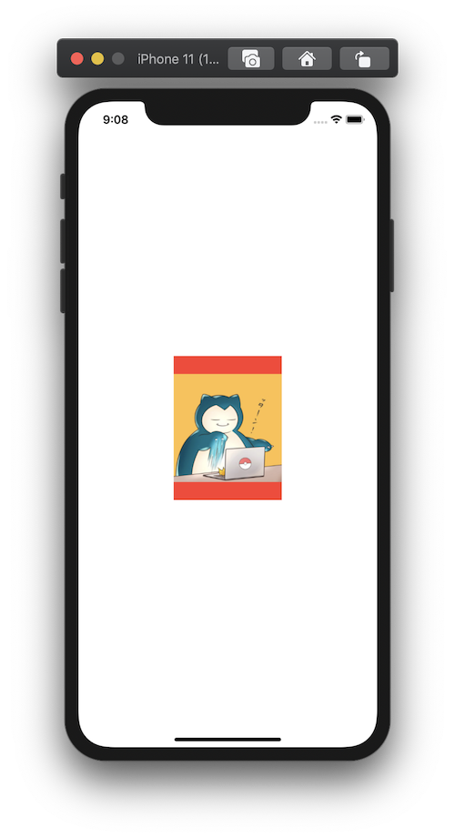

+++
title =  "SwiftUIで画像をリサイズして表示（fit）"
url = "2020-09-05"
date = "2020-09-05"
description = "SwiftUIで画像をリサイズして表示（fit）"
tags = ["iOS", "Swift", "SwiftUI"]
categories = ["iOS", "SwiftUI"]
archives = "2020/09"
+++

<br>

SwiftUIで画像をリサイズして表示します。
アスペクト比が異なる場合は余白が赤色で表示されます。



<!-- Google Ads -->


<!-- Amazon Ads -->


<!--more-->

**ContentView.swift**

```swift
import SwiftUI

struct ContentView: View {    
    var body: some View {
        Image("icon")
            .resizable()
            .aspectRatio(contentMode: .fit)
            .frame(width: 150, height: 200)
            .background(Color.red)
    }
}

struct ContentView_Previews: PreviewProvider {
    static var previews: some View {
        ContentView()
    }
}
```

