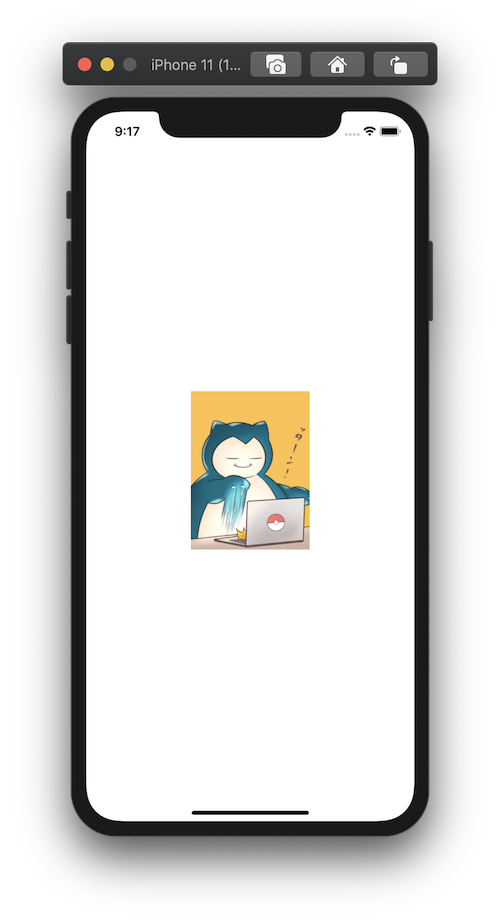

+++
title =  "SwiftUIで画像をリサイズして表示（clip）"
url = "2020-09-06"
date = "2020-09-06"
description = "SwiftUIで画像をリサイズして表示（clip）"
tags = ["iOS", "Swift", "SwiftUI"]
categories = ["iOS", "SwiftUI"]
archives = "2020/09"
+++

<br>

SwiftUIで画像をリサイズして表示します。
アスペクト比が異なる場合ははみ出た箇所を切り取って表示します。



<!-- Google Ads -->


<!-- Amazon Ads -->


<!--more-->

**ContentView.swift**

```swift
import SwiftUI

struct ContentView: View {
    var body: some View {
        Image("icon")
            .resizable()
            .scaledToFill()
            .frame(width: 150, height: 200)
            .clipped()
            .background(Color.red)
    }
}

struct ContentView_Previews: PreviewProvider {
    static var previews: some View {
        ContentView()
    }
}
```

