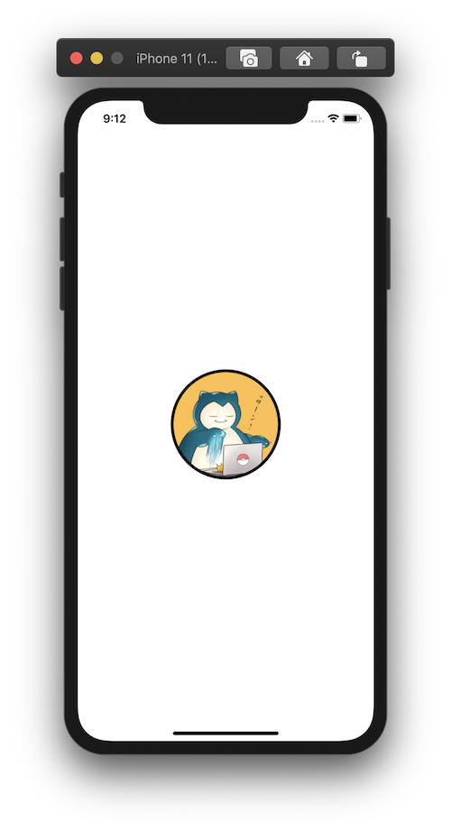

+++
title =  "SwiftUIで画像を丸く切り取り、枠を付ける"
url = "2020-09-07"
date = "2020-09-07"
description = "SwiftUIで画像を丸く切り取り、枠を付ける"
tags = ["iOS", "Swift", "SwiftUI"]
categories = ["iOS", "SwiftUI"]
archives = "2020/09"
+++

<br>

SwiftUIで丸い枠に合わせて画像を丸く切り取り、枠を付ける方法です。
アイコンの表示する箇所などによく使います。



<!-- Google Ads -->


<!-- Amazon Ads -->


<!--more-->

**ContentView.swift**

```swift
import SwiftUI

struct ContentView: View {
    var body: some View {
        Image("icon")
            .resizable()
            .scaledToFill()
            .frame(width: 150, height: 150)
            .cornerRadius(75)
            .overlay(
                RoundedRectangle(cornerRadius: 75).stroke(Color.black, lineWidth: 4)
        )
    }
}

struct ContentView_Previews: PreviewProvider {
    static var previews: some View {
        ContentView()
    }
}
```

