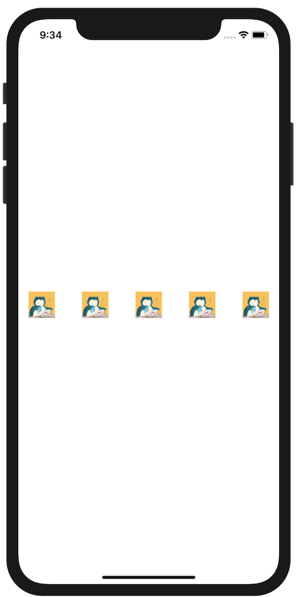

+++
title =  "SwiftUIでViewを横に等間隔で横に並べる"
url = "2020-09-08"
date = "2020-09-08"
description = "SwiftUIでViewを横に等間隔で横に並べる"
tags = ["iOS", "Swift", "SwiftUI"]
categories = ["iOS", "SwiftUI"]
archives = "2020/09"
+++

<br>

SwiftUIでViewを横に等間隔で横に並べて表示するほうほうです。
アイコンを等間隔で表示したりするときにつかいました。



<!-- Google Ads -->


<!-- Amazon Ads -->


<!--more-->

**ContentView.swift**

```swift
import SwiftUI

struct ContentView: View {
    var body: some View {
        HStack {
            Image("icon")
                .resizable()
                .frame(width: 42, height: 42)
            Spacer()
            Image("icon")
                .resizable()
                .frame(width: 42, height: 42)
            Spacer()
            Image("icon")
                .resizable()
                .frame(width: 42, height: 42)
            Spacer()
            Image("icon")
                .resizable()
                .frame(width: 42, height: 42)
            Spacer()
            Image("icon")
                .resizable()
                .frame(width: 42, height: 42)
        }
        .padding(16)
    }
}

struct ContentView_Previews: PreviewProvider {
    static var previews: some View {
        ContentView()
    }
}
```

