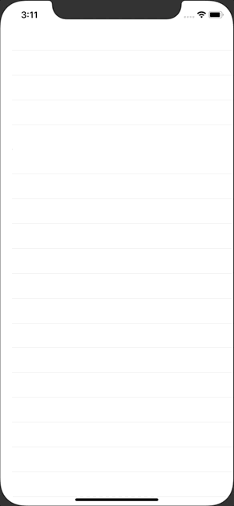

+++
title =  "GithubのAPIを叩き、SwiftUIでリポジトリの情報をリストに表示する（Closure）"
url = "2020-09-09"
date = "2020-09-09"
description = "SwiftUIでGithubのAPIを叩き、SwiftUIでリポジトリの情報をリストに表示する（Closure）"
tags = ["iOS", "Swift", "SwiftUI"]
categories = ["iOS", "SwiftUI"]
archives = "2020/09"
+++

<br>

GithubのAPIを叩き、SwiftUIでリポジトリの情報をリストに表示する方法です。
[Infinite List Scroll with SwiftUI and Combine](https://www.vadimbulavin.com/infinite-list-scroll-swiftui-combine/) を参考にさせていただきました。



<!-- Google Ads -->


<!-- Amazon Ads -->


<!--more-->

**ContentView.swift**

```swift
import SwiftUI

enum GithubAPI {
    static func searchRepos(page: Int, perPage: Int, completion: @escaping (Result<[Repository], Error>) -> Void) {
        let url = URL(string: "https://api.github.com/search/repositories?q=swift&sort=stars&page=\(page)&per_page=\(perPage)")!
        let task = URLSession.shared.dataTask(with: url){ data, response, error in
            if let error = error {
                completion(Result.failure(error))
                return
            }
            do {
                let repositories = try JSONDecoder().decode(GithubSearchResult.self, from: data!).items
                completion(Result.success(repositories))
            } catch let error {
                completion(Result.failure(error))
            }
        }
        task.resume()
    }
}

struct GithubSearchResult: Codable {
    let items: [Repository]
}

struct Repository: Codable, Identifiable, Equatable {
    let id: Int
    let name: String
    let description: String?
    let stargazersCount: Int
    
    enum CodingKeys: String, CodingKey {
        case id
        case name
        case description
        case stargazersCount = "stargazers_count"
    }
}

struct ContentView: View {
    @State private var repositories: [Repository] = []
    @State private var showingAlert = false
    @State private var errorMessage = ""
    
    var body: some View {
        List(repositories) { repository in
            VStack(alignment: .leading) {
                Text(repository.name)
                    .font(Font.system(size: 24).bold())
                Text(repository.description ?? "")
                Text("Start: \(repository.stargazersCount)")
            }
        }.onAppear {
            GithubAPI.searchRepos(page: 1, perPage: 30) { result in
                switch result {
                case let .success(repositories):
                    DispatchQueue.main.async {
                        self.repositories = repositories
                    }
                case let .failure(error):
                    DispatchQueue.main.async {
                        self.errorMessage = error.localizedDescription
                        self.showingAlert = true
                    }
                }
            }
        }
        .alert(isPresented: self.$showingAlert) {
            Alert(
                title: Text("Error"),
                message: Text(self.errorMessage),
                dismissButton: .default(Text("Close")))
        }
    }
}

struct ContentView_Previews: PreviewProvider {
    static var previews: some View {
        ContentView()
    }
}
```

