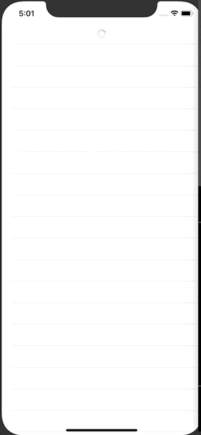

+++
title =  "GithubのAPIを叩き、SwiftUIでリポジトリを取得する。一番最後までいくと追加で取得しIndicator を表示する"
url = "2020-09-12"
date = "2020-09-12"
description = "GithubのAPIを叩き、SwiftUIでリポジトリを取得する。一番最後までいくと追加で取得しIndicator を表示する"
tags = ["iOS", "Swift", "SwiftUI"]
categories = ["iOS", "SwiftUI"]
archives = "2020/09"
+++

<br>

GithubのAPIを叩き、リポジトリを取得する。一番最後までいくと追加で取得しIndicator を表示する方法です。
[Infinite List Scroll with SwiftUI and Combine](https://www.vadimbulavin.com/infinite-list-scroll-swiftui-combine/) を参考にさせていただきました。



<!-- Google Ads -->


<!-- Amazon Ads -->


<!--more-->

**ContentView.swift**

```swift
import SwiftUI
import Combine

enum GithubAPI {
    static func searchRepos(page: Int, perPage: Int) -> AnyPublisher<[Repository], Error> {
        let url = URL(string: "https://api.github.com/search/repositories?q=swift&sort=stars&page=\(page)&per_page=\(perPage)")!
        return URLSession.shared
            .dataTaskPublisher(for: url)
            .tryMap { try JSONDecoder().decode(GithubSearchResult.self, from: $0.data).items }
            .receive(on: DispatchQueue.main)
            .eraseToAnyPublisher()
    }
}

struct GithubSearchResult: Codable {
    let items: [Repository]
}

struct Repository: Codable, Identifiable, Equatable {
    let id: Int
    let name: String
    let description: String?
    let stargazersCount: Int
    
    enum CodingKeys: String, CodingKey {
        case id
        case name
        case description
        case stargazersCount = "stargazers_count"
    }
}

struct Spinner: UIViewRepresentable {
    func makeUIView(context: Context) -> UIActivityIndicatorView {
        let spinner = UIActivityIndicatorView(style: .medium)
        spinner.hidesWhenStopped = true
        spinner.startAnimating()
        return spinner
    }
    
    func updateUIView(_ uiView: UIActivityIndicatorView, context: Context) {}
}

struct ContentView: View {
    @State private var repositories: [Repository] = []
    @State private var page = 1
    @State private var isFetching = false
    @State private var subscriptions = Set<AnyCancellable>()
    @State private var showingAlert = false
    @State private var errorMessage = ""
    
    var body: some View {
        List {
            ForEach(repositories) { repository in
                VStack(alignment: .leading) {
                    Text(repository.name)
                        .font(Font.system(size: 24).bold())
                    Text(repository.description ?? "")
                    Text("Star: \(repository.stargazersCount)")
                }
                .onAppear {
                    if self.repositories.last == repository {
                        self.fetchRepositories()
                    }
                }
            }
            
            if self.isFetching {
                Spinner()
                    .frame(idealWidth: .infinity, maxWidth: .infinity, alignment: .center)
            }
        }
        .onAppear {
            self.fetchRepositories()
        }
        .alert(isPresented: self.$showingAlert) {
            Alert(
                title: Text("Error"),
                message: Text(self.errorMessage),
                dismissButton: .default(Text("Close")))
        }
    }
    
    private func fetchRepositories() {
        guard !isFetching else { return }
        
        isFetching = true
        GithubAPI.searchRepos(page: self.page, perPage: 30)
            .sink(receiveCompletion: { completion in
                switch completion {
                case .finished:
                    self.isFetching = false
                    break
                case let .failure(error):
                    self.isFetching = false
                    self.showingAlert = true
                    self.errorMessage = error.localizedDescription
                }
            }, receiveValue: { repositories in
                self.repositories += repositories
                self.page += 1
            })
            .store(in: &self.subscriptions)
    }
}

struct ContentView_Previews: PreviewProvider {
    static var previews: some View {
        ContentView()
    }
}
```

