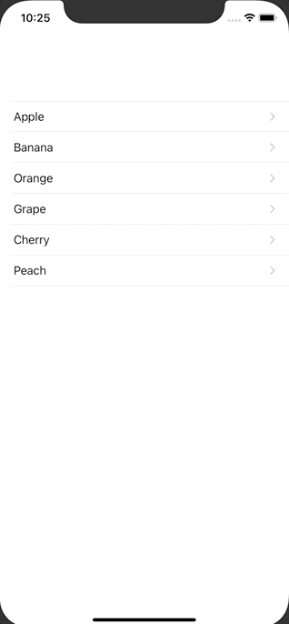

+++
title =  "SwiftUIで画面遷移時に値を渡す"
url = "2020-09-13"
date = "2020-09-13"
description = "SwiftUIで画面遷移時に値を渡す"
tags = ["iOS", "Swift", "SwiftUI"]
categories = ["iOS", "SwiftUI"]
archives = "2020/09"
+++

<br>

SwiftUIで画面遷移時に値を渡す方法です。
`ContentView` ではフルーツの一覧を表示しています。
フルーツが表示されたセルを押すと `SecondView` に遷移し、選択されたセルのフルーツ名が表示されます。



<!-- Google Ads -->


<!-- Amazon Ads -->


<!--more-->

**ContentView.swift**

```swift
import SwiftUI

struct ContentView: View {
    let fruits = ["Apple", "Banana", "Orange", "Grape", "Cherry", "Peach"]
    
    var body: some View {
        NavigationView {
            List(fruits, id: \.self) { fruit in
                NavigationLink(destination: SecondView(fruit: fruit)) {
                    Text(fruit)
                }
            }
        }
    }
}

struct ContentView_Previews: PreviewProvider {
    static var previews: some View {
        ContentView()
    }
}
```


**SecondView.swift**

```swift
import SwiftUI

struct SecondView: View {
    let fruit: String
    
    var body: some View {
        Text(fruit)
    }
}

struct SecondView_Previews: PreviewProvider {
    static var previews: some View {
        SecondView(fruit: "Apple")
    }
}
```

