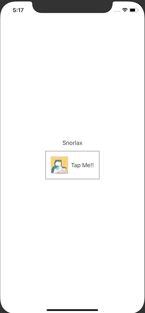

+++
title =  "SwiftUIでButton内の画像やテキストの色を変えない"
url = "2020-09-14"
date = "2020-09-14"
description = "SwiftUIでButton内の画像やテキストの色を変えない"
tags = ["iOS", "Swift", "SwiftUI"]
categories = ["iOS", "SwiftUI"]
archives = "2020/09"
+++

<br>

SwiftUIでButton内の画像やテキストの色を変えない方法です。
`.buttonStyle(PlainButtonStyle())` ではフルーツの一覧を表示しています。
フルーツが表示されたセルを押すと `SecondView` を設定することで実現できました。



<!-- Google Ads -->


<!-- Amazon Ads -->


<!--more-->

**ContentView.swift**

```swift
import SwiftUI

struct ContentView: View {
    @State var text = "Snorlax"
    
    var body: some View {
        VStack {
            Text(text)
            Button(action: {
                self.text = "Forever"
            }) {
                HStack {
                    Image("icon")
                        .resizable()
                        .scaledToFill()
                        .frame(width: 50, height: 50)
                    Text("Tap Me!!")
                }
                .padding()
                .border(Color.gray, width: 2)
            }.buttonStyle(PlainButtonStyle())
        }
    }
}

struct ContentView_Previews: PreviewProvider {
    static var previews: some View {
        ContentView()
    }
}
```

