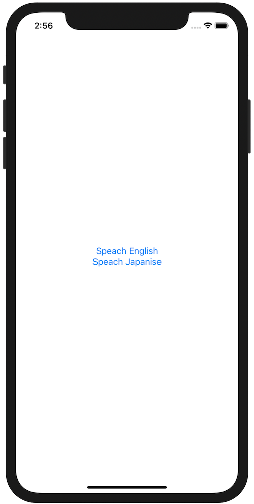

+++
title =  "Swiftで文章を読み上げる（音声合成）"
url = "2020-09-15"
date = "2020-09-15"
description = "Swiftで文章を読み上げる（音声合成）"
tags = ["iOS", "Swift", "SwiftUI"]
categories = ["iOS", "Swift"]
archives = "2020/09"
+++

<br>

Swiftで文章を読み上げる（音声合成）方法です。
`AVFoundation` を import し、以下のコードを書くことで iPhone に文字列を読み上げてもらうことができます。



<!-- Google Ads -->


<!-- Amazon Ads -->


<!--more-->

**ContentView.swift**

```swift
import SwiftUI
import AVFoundation

struct ContentView: View {
    var body: some View {
        Button("Speach English") {
            let synthesizer = AVSpeechSynthesizer()
            let utterance = AVSpeechUtterance(string: "I love Snorlax")
            utterance.voice = AVSpeechSynthesisVoice(language: "en-US")
            synthesizer.speak(utterance)
        }
        
        VStack {
            Button("Speach Japanise") {
                let synthesizer = AVSpeechSynthesizer()
                let utterance = AVSpeechUtterance(string: "私はカビゴンが好きです")
                utterance.voice = AVSpeechSynthesisVoice(language: "ja-JP")
                synthesizer.speak(utterance)
            }
        }
    }
}

struct ContentView_Previews: PreviewProvider {
    static var previews: some View {
        ContentView()
    }
}
```

