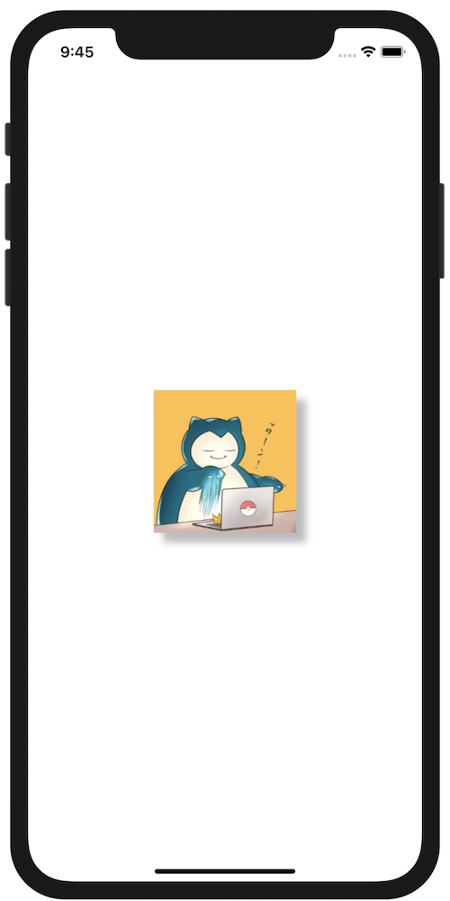

+++
title =  "SwiftUIでViewの周りに影をつける"
url = "2020-10-01"
date = "2020-10-01"
description = "SwiftUIでViewの周りに影をつける"
tags = ["iOS", "Swift", "SwiftUI"]
categories = ["iOS", "SwiftUI"]
archives = "2020/10"
+++

<br>

SwiftでUIViewの周りに影をつける方法です。
ImageのViewの周りに影をつけています。
`shadowOffset` で影の位置を移動させることができ、サンプルコードでは影を右下に移動させています。



<!-- Google Ads -->


<!-- Amazon Ads -->


<!--more-->

**ContentView.swift**

```swift
import SwiftUI

struct ContentView: View {
    var body: some View {
        VStack {
            Image("icon")
                .resizable()
                .frame(width: 150, height: 150)
                .shadow(color: Color.gray.opacity(0.6), radius: 4, x: 10, y: 10)
        }
    }
}
```

