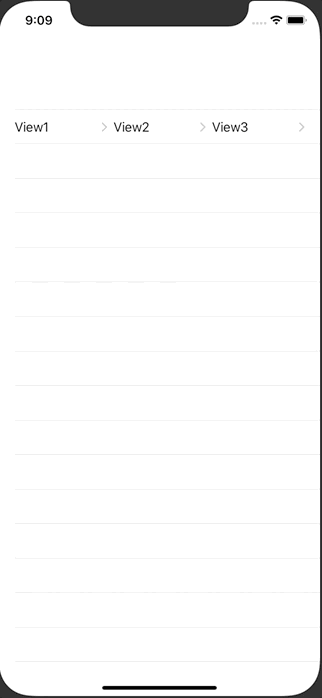
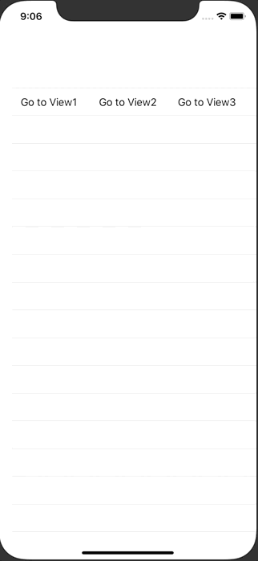

+++
title =  "SwiftUIでListの中に複数のNavigationLinkを設置する"
url = "2020-10-07"
date = "2020-10-07"
description = "SwiftUIでListの中に複数のNavigationLinkを設置する"
tags = ["iOS", "Swift", "SwiftUI"]
categories = ["iOS", "Swift", "SwiftUI"]
archives = "2020/10"
+++

<br>

SwiftUIでListの中に複数のNavigationLinkを設置する方法です。
素直に実装すると画面遷移が暴発してしまいます。



それを修正するために List のタップジェスチャーを無効化したりする必要がありました。



<!-- Google Ads -->


<!-- Amazon Ads -->


<!--more-->

**ContentView.swift**

```swift
import SwiftUI

struct ContentView: View {
    var body: some View {
        NavigationView {
            List {
                HStack {
                    ProgrammaticNavigationView {
                        Text("View1")
                    } label: {
                        Text("Go to View1")
                    }

                    ProgrammaticNavigationView {
                        Text("View2")
                    } label: {
                        Text("Go to View2")
                    }

                    ProgrammaticNavigationView {
                        Text("View3")
                    } label: {
                        Text("Go to View3")
                    }
                }
            }
            .onTapGesture {
                return
            }
        }
    }
}

struct ProgrammaticNavigationView<Content>: View where Content: View {
    let destination: () -> Content
    let label: () -> Content
    @State var isActive = false
    var body: some View {
        ZStack {
            Button(action: { isActive = true }) {
                label()
            }
            .buttonStyle(PlainButtonStyle())
            NavigationLink(destination: destination(), isActive: $isActive) {
                EmptyView()
            }
        }
    }
}

struct ContentView_Previews: PreviewProvider {
    static var previews: some View {
        ContentView()
    }
}
```

