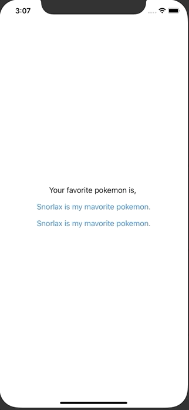

+++
title =  "SwiftUIでAppStorageを使ってUserDefaultの値を監視する"
url = "2020-10-08"
date = "2020-10-08"
description = "SwiftUIでAppStorageを使ってUserDefaultの値を監視する"
tags = ["iOS", "Swift", "SwiftUI"]
categories = ["iOS", "Swift", "SwiftUI"]
archives = "2020/10"
+++

<br>

SwiftUIでAppStorageを使ってUserDefaultの値を監視する方法です。
UserDefaultが変更されると画面が再描画されます。



<!-- Google Ads -->


<!-- Amazon Ads -->


<!--more-->

**ContentView.swift**

```swift
import SwiftUI

struct ContentView: View {
    @AppStorage("FAVORITE_POKEMON_NAME") var favoritePokemonName: String = ""

    var body: some View {
        VStack(spacing: 16) {
            Text("Your favorite pokemon is, \(favoritePokemonName)")

            Button("Snorlax is my mavorite pokemon.") {
                favoritePokemonName = "Snorlax"
            }
            
            Button("Snorlax is my mavorite pokemon.") {
                UserDefaults.standard.set("Slowpoke", forKey: "FAVORITE_POKEMON_NAME")
            }
        }
    }
}
```

