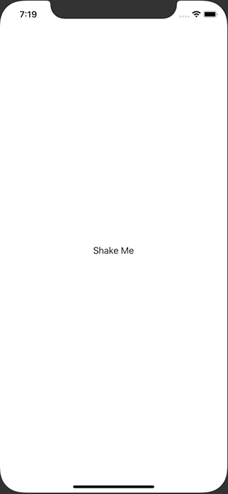

+++
title =  "SwiftUIで端末のシェイクを検知する"
url = "2020-11-01"
date = "2020-11-01"
description = "SwiftUIで端末のシェイクを検知する"
tags = ["iOS", "Swift", "SwiftUI"]
categories = ["iOS", "Swift", "SwiftUI"]
archives = "2020/11"
+++

<br>

SwiftUIで端末のシェイクを検知する方法です。
端末をシェイクすると Text 内の文字が変わります。
ReactNativeは端末をシェイクするとデバッグメニューが出てくるのが面白いです。



<!-- Google Ads -->


<!-- Amazon Ads -->


<!--more-->

**ContentView.swift**

```swift
import SwiftUI

struct ContentView: View {
    @State private var message = "Shake Me"

    var body: some View {
        Text(message)
            .onReceive(NotificationCenter.default.publisher(for: .deviceDidShakeNotification)) { _ in
                self.message = "Device Did Shake"
        }
    }
}

extension NSNotification.Name {
    public static let deviceDidShakeNotification = NSNotification.Name("DeviceDidShakeNotification")
}

extension UIWindow {
    open override func motionEnded(_ motion: UIEvent.EventSubtype, with event: UIEvent?) {
        super.motionEnded(motion, with: event)
        NotificationCenter.default.post(name: .deviceDidShakeNotification, object: event)
    }
}

struct ContentView_Previews: PreviewProvider {
    static var previews: some View {
        ContentView()
    }
}
```

