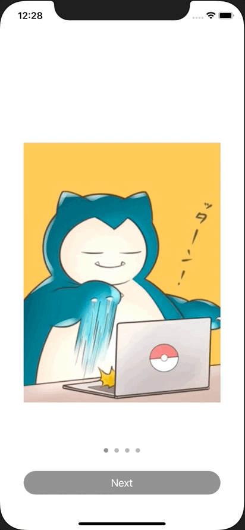

+++
title =  "画面内にPageViewControllerがあるウォークスルー画面を実装する"
url = "2020-11-02"
date = "2020-11-02"
description = "画面内にPageViewControllerがあるウォークスルー画面を実装する"
tags = ["iOS", "Swift", "UIKit"]
categories = ["Swift", "UIKit"]
archives = "2020/11"
+++

<br>

画面内にPageViewControllerがあるウォークスルー画面を実装する方法です。
一番最後のページを開くとボタンの色が変わります。



<!-- Google Ads -->


<!-- Amazon Ads -->


<!--more-->

**ViewController.swift**

```swift
import UIKit

class ViewController: UIViewController {
    lazy var pageViewController = UIPageViewController(transitionStyle: .scroll, navigationOrientation: .horizontal, options: nil)
    var viewControllers: [UIViewController] = []
    let images: [UIImage] = [UIImage(named: "icon")!, UIImage(named: "slowpoke")!, UIImage(named: "quagsire")!, UIImage(named: "diglett")!]
    lazy var pageControl = UIPageControl()
    let nextButton = UIButton()
    
    override func viewDidLoad() {
        super.viewDidLoad()
        
        view.backgroundColor = .white
        
        // Init ViewControllers
        let contentRect = CGRect(x: 40, y: 240, width: view.bounds.width - 80, height: 440)
        for index in 0 ..< images.count {
            let viewController = UIViewController()
            viewController.view.backgroundColor = .white
            viewController.view.tag = index
            
            let imageView = UIImageView()
            imageView.frame.size = contentRect.size
            imageView.image = images[index]
            imageView.contentMode = .scaleAspectFill
            imageView.clipsToBounds = true
            imageView.backgroundColor = .red
            viewController.view.addSubview(imageView)
            
            viewControllers.append(viewController)
        }
        
        // Set PageViewController
        pageViewController.dataSource = self
        pageViewController.delegate = self
        pageViewController.setViewControllers([viewControllers.first!], direction: .forward, animated: true, completion: nil)
        pageViewController.view.frame = contentRect
        view.addSubview(pageViewController.view!)
        
        // Set PageControl
        pageControl.frame = CGRect(x:0, y:view.bounds.height - 160, width:view.bounds.width, height:50)
        pageControl.pageIndicatorTintColor = .lightGray
        pageControl.currentPageIndicatorTintColor = .gray
        pageControl.numberOfPages = images.count
        pageControl.currentPage = 0
        pageControl.isUserInteractionEnabled = false
        view.addSubview(pageControl)
        
        // Set NextButton
        nextButton.frame = CGRect(x: 40, y: view.bounds.size.height - 100, width: view.bounds.size.width - 80, height: 40)
        nextButton.setTitle("Next", for: .normal)
        nextButton.layer.cornerRadius = 20
        nextButton.clipsToBounds = true
        nextButton.backgroundColor = .gray
        nextButton.addTarget(self, action: #selector(nextButtonTapped), for: .touchUpInside)
        view.addSubview(nextButton)
    }
    
    @objc func nextButtonTapped() {
        print("nextButtonTapped")
    }
    
    private func setNextButtonStatus(index: Int) {
        if index == images.count - 1 {
            // last page
            nextButton.backgroundColor = .orange
            nextButton.isEnabled = true
        } else {
            // Other than the last page
            nextButton.backgroundColor = .gray
            nextButton.isEnabled = false
        }
    }
}

extension ViewController: UIPageViewControllerDataSource {
    func pageViewController(_ pageViewController: UIPageViewController, viewControllerAfter viewController: UIViewController) -> UIViewController? {
        var index = viewController.view.tag
        pageControl.currentPage = index
        setNextButtonStatus(index: index)
        
        if index == images.count - 1{
            return nil
        }
        index = index + 1
        return viewControllers[index]
    }
    
    func pageViewController(_ pageViewController: UIPageViewController, viewControllerBefore viewController: UIViewController) -> UIViewController? {
        var index = viewController.view.tag
        pageControl.currentPage = index
        setNextButtonStatus(index: index)
        
        index = index - 1
        if index < 0{
            return nil
        }
        return viewControllers[index]
    }
}

extension ViewController: UIPageViewControllerDelegate {
    func pageViewController(_ pageViewController: UIPageViewController, didFinishAnimating: Bool, previousViewControllers: [UIViewController], transitionCompleted: Bool) {
        print("didFinishAnimating")
    }
}
```

