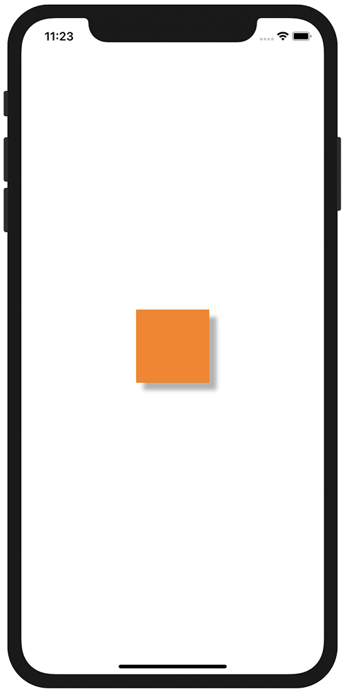

+++
title =  "UIViewに影をつける"
url = "2020-11-04"
date = "2020-11-04"
description = "UIViewに影をつける"
tags = ["iOS", "Swift", "UIKit"]
categories = ["iOS", "Swift"]
archives = "2020/11"
+++

<br>

UIViewに影をつける方法です。
オレンジ色のUIView の周りに影をつけています。
影があると浮き上がって見えるの不思議ですね。



<!-- Google Ads -->


<!-- Amazon Ads -->


<!--more-->

**ViewController.swift**

```swift
import UIKit

class ViewController: UIViewController {

    override func viewDidLoad() {
        super.viewDidLoad()
        
        view.backgroundColor = .white
    
        let shadowView = UIView()
        shadowView.frame.size = CGSize(width: 100, height: 100)
        shadowView.center = view.center
        shadowView.backgroundColor = .orange
        shadowView.layer.shadowOpacity = 0.3
        shadowView.layer.shadowOffset = CGSize(width: 10, height: 10)
        view.addSubview(shadowView)
    }
}
```

