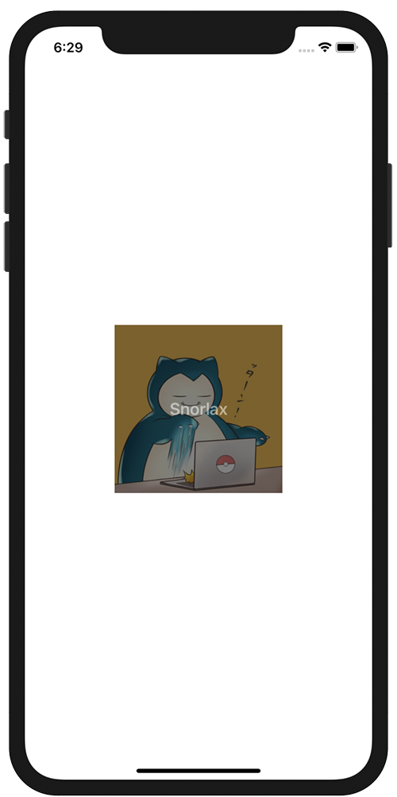

+++
title =  "SwiftUIでViewの上にViewを重ねる"
url = "2020-11-06"
date = "2020-11-06"
description = "SwiftUIでViewの上にViewを重ねる"
tags = ["Swift", "SwiftUI"]
categories = ["Swift", "SwiftUI"]
archives = "2020/11"
+++

<br>

SwiftUIでViewの上にViewを重ねる方法です。
Imageの上に半透明に黒いTextを重ねています。



<!-- Google Ads -->


<!-- Amazon Ads -->


<!--more-->

**ContentView.swift**

```swift
import SwiftUI

struct ContentView: View {
    var body: some View {
        Image("icon")
            .resizable()
            .frame(width: 200, height: 200)
            .overlay(
                Text("Snorlax")
                    .foregroundColor(Color.white)
                    .font(Font.system(size: 20).bold())
                    .frame(minWidth: 0, maxWidth: .infinity, minHeight: 0, maxHeight: .infinity)
                    .background(Color.black)
                    .opacity(0.5)
            )
    }
}

struct ContentView_Previews: PreviewProvider {
    static var previews: some View {
        ContentView()
    }
}

```

