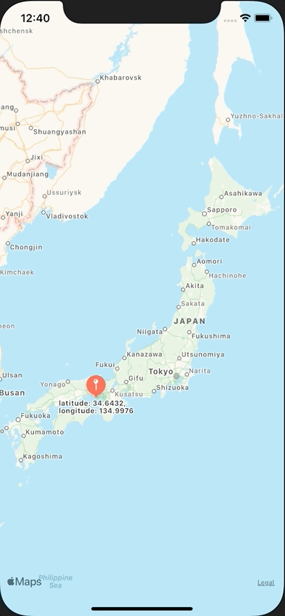

+++
title =  "SwiftUIでMapを使う。Mapにピンを立てる"
url = "2020-11-07"
date = "2020-11-07"
description = "SwiftUIでMapを使う。Mapにピンを立てる"
tags = ["Swift", "SwiftUI"]
categories = ["Swift", "SwiftUI"]
archives = "2020/11"
+++

<br>

SwiftUIでMapを使う。Mapにピンを立てる方法です。
UIViewRepresentableを使って MKMapViewをSwiftUIで表示しています。



<!-- Google Ads -->


<!-- Amazon Ads -->


<!--more-->

**ContentView.swift**

```swift
import SwiftUI
import MapKit

struct ContentView: View {
    @State var showingAlert = false
    @State var selectedLocation: CLLocationCoordinate2D?
    @State var locations: [CLLocationCoordinate2D] = []
    
    var body: some View {
        MapView(locations: $locations) { location in
            self.selectedLocation = location
            self.showingAlert = true
        }
        .onAppear {
            let location = CLLocationCoordinate2D(latitude: CLLocationDegrees(34.6432), longitude: CLLocationDegrees(134.9976))
            locations.append(location)
        }
        .alert(isPresented: $showingAlert) {
            Alert(
                title: Text(""),
                message: Text("latitude: \(selectedLocation?.latitude ?? -1), longitude: \(selectedLocation?.longitude ?? -1)"),
                primaryButton: .default(Text("OK")) {
                    guard let location = selectedLocation else {
                        return
                    }
                    self.addLocation(location: location)
                }, secondaryButton: .cancel())
        }
        .frame(minWidth: /*@START_MENU_TOKEN@*/0/*@END_MENU_TOKEN@*/, maxWidth: /*@START_MENU_TOKEN@*/.infinity/*@END_MENU_TOKEN@*/, minHeight: /*@START_MENU_TOKEN@*/0/*@END_MENU_TOKEN@*/, maxHeight: .infinity)
        .ignoresSafeArea(.all, edges: .all)
    }
    
    private func addLocation(location: CLLocationCoordinate2D) {
        locations.append(location)
    }
}

struct ContentView_Previews: PreviewProvider {
    static var previews: some View {
        ContentView()
    }
}
```


**MapView.swift**

```swift
import SwiftUI
import MapKit
import UIKit

protocol TapplableMapViewDelegate: AnyObject {
    func mapViewDidTap(location: CLLocationCoordinate2D)
}

class TapplableMapView: UIView {
    private lazy var mapView = MKMapView()
    weak var delegate: TapplableMapViewDelegate?
    
    required init?(coder aDecoder: NSCoder) {
        super.init(coder: aDecoder)
    }
    
    override init(frame: CGRect) {
        super.init(frame: frame)
        
        let tapGestureRecognizer = UITapGestureRecognizer()
        tapGestureRecognizer.addTarget(self, action: #selector(onTap(sender:)))
        
        mapView.addGestureRecognizer(tapGestureRecognizer)
        self.backgroundColor = .red
        addSubview(mapView)
    }
    
    override func layoutSubviews() {
        mapView.frame =  CGRect(x: 0, y: 0, width: bounds.width, height: bounds.height)
    }
    
    @objc func onTap(sender: UITapGestureRecognizer) {
        let tapPoint = sender.location(in: mapView)
        let location = mapView.convert(tapPoint, toCoordinateFrom: mapView)
        delegate?.mapViewDidTap(location: location)
    }
    
    func addAnnotation(_ annotation: MKAnnotation) {
        mapView.addAnnotation(annotation)
    }
}

struct MapView: UIViewRepresentable {
    @Binding var locations: [CLLocationCoordinate2D]
    
    let mapViewDidTap: (_ location: CLLocationCoordinate2D) -> Void
    final class Coordinator: NSObject, TapplableMapViewDelegate {
        private var mapView: MapView
        let mapViewDidTap: (_ location: CLLocationCoordinate2D) -> Void
        
        init(_ mapView: MapView, mapViewDidTap: @escaping (_ location: CLLocationCoordinate2D) -> Void) {
            self.mapView = mapView
            self.mapViewDidTap = mapViewDidTap
        }
        
        func mapViewDidTap(location: CLLocationCoordinate2D) {
            mapViewDidTap(location)
        }
    }
    
    func makeCoordinator() -> Coordinator {
        Coordinator(self, mapViewDidTap: mapViewDidTap)
    }
    
    func makeUIView(context: Context) -> TapplableMapView {
        let mapView = TapplableMapView()
        mapView.delegate = context.coordinator
        return mapView
    }
    
    func updateUIView(_ uiView: TapplableMapView, context: Context) {
        for location in locations {
            let annotation = MKPointAnnotation()
            let centerCoordinate = location
            annotation.coordinate = centerCoordinate
            annotation.title = "latitude: \(location.latitude), longitude: \(location.longitude)"
            uiView.addAnnotation(annotation)
        }
    }
}
```

