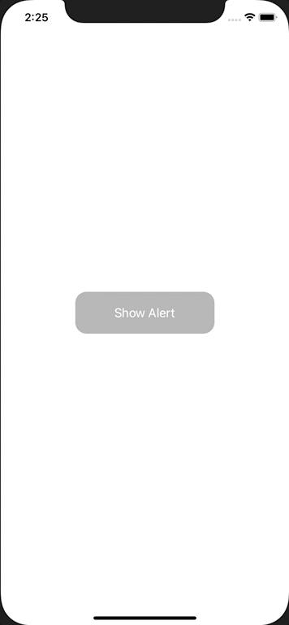

+++
title =  "UIAlertControllerの中でTextFieldを使い、文字数を制限する"
url = "2020-11-09"
date = "2020-11-09"
description = "UIAlertControllerの中でTextFieldを使い、文字数を制限する"
tags = ["iOS", "Swift", "UIKit"]
categories = ["Swift", "UIKit"]
archives = "2020/11"
+++

<br>

UIAlertControllerの中でTextFieldを使い、文字数を制限する方法です。
このサンプルでは6文字以上入力できないようにしています。



<!-- Google Ads -->


<!-- Amazon Ads -->


<!--more-->

**ViewController.swift**

```swift
import UIKit

class ViewController: UIViewController {
    
    override func viewDidLoad() {
        super.viewDidLoad()
        
        view.backgroundColor = .white
        
        let button = UIButton()
        button.setTitle("Show Alert", for: .normal)
        button.backgroundColor = .lightGray
        button.frame.size = CGSize(width: 200, height: 60)
        button.center = view.center
        button.layer.cornerRadius = 16
        button.addTarget(self, action: #selector(buttonTapped), for: .touchUpInside)
        view.addSubview(button)
    }
    
    @objc func buttonTapped() {
        let alert: UIAlertController = UIAlertController(title: "Title", message: "Message", preferredStyle: UIAlertController.Style.alert)
        alert.addTextField(configurationHandler: nil)
        alert.textFields?.first?.placeholder = "Input Text"
        alert.textFields?.first?.addTarget(self, action: #selector(textFieldDidChange), for: .allEditingEvents)
        let saveTitleAction: UIAlertAction = UIAlertAction(title: "OK", style: UIAlertAction.Style.default, handler: { (_: UIAlertAction!) -> Void in
            guard let text = alert.textFields?.first?.text, !text.isEmpty else {
                return
            }
            print(text)
        })
        let cancelAction: UIAlertAction = UIAlertAction(title: "Cencel", style: UIAlertAction.Style.cancel, handler: nil)
        alert.addAction(saveTitleAction)
        alert.addAction(cancelAction)
        present(alert, animated: true, completion: nil)
    }
    
    @objc func textFieldDidChange(_ textField: UITextField) {
        if let text = textField.text, text.count > 5 {
            textField.text = String(text.prefix(5))
        }
    }
}
```

