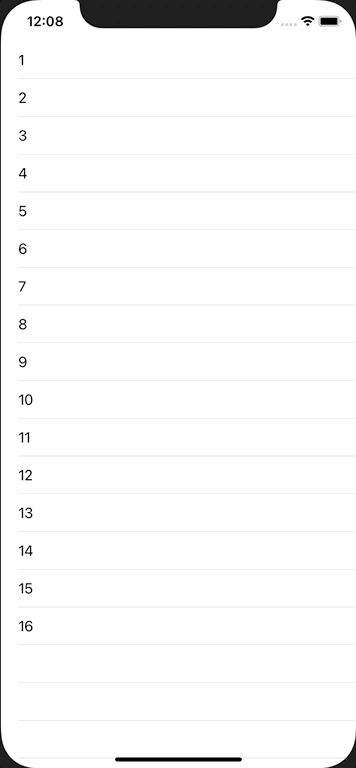

+++
title =  "TableViewでセルのロングタップを検出する"
url = "2020-11-10"
date = "2020-11-10"
description = "TableViewでセルのロングタップを検出する"
tags = ["iOS", "Swift", "UIKit"]
categories = ["Swift", "UIKit"]
archives = "2020/11"
+++

<br>

TableViewでセルのロングタップを検出する方法です。
通常のタップとロングタップをそれぞれのイベントとして取得することができます。



<!-- Google Ads -->


<!-- Amazon Ads -->


<!--more-->

**ViewController.swift**

```swift
import UIKit

class ViewController: UIViewController {
    private lazy var tableView = UITableView()

    override func viewDidLoad() {
        super.viewDidLoad()
        
        view.backgroundColor = .white
        
        tableView.frame = view.bounds
        tableView.register(UITableViewCell.self, forCellReuseIdentifier: NSStringFromClass(UITableViewCell.self))
        tableView.dataSource = self
        tableView.delegate = self
        view.addSubview(tableView)
        
        let longPressGesture = UILongPressGestureRecognizer(target: self, action: #selector(handleLongPress))
        longPressGesture.minimumPressDuration = 0.5
         longPressGesture.allowableMovement = 10
        tableView.addGestureRecognizer(longPressGesture)
    }
    
    @objc func handleLongPress(longPressGesture: UILongPressGestureRecognizer) {
        guard longPressGesture.state == .ended else {
            return
        }
        
        let point = longPressGesture.location(in: tableView)
        guard let indexPath = tableView.indexPathForRow(at: point) else {
            return
        }
        print("CellLongTapped, index=\(indexPath.row)")
        tableView.deselectRow(at: indexPath, animated: true)
    }
}

extension ViewController: UITableViewDataSource {
    func tableView(_ tableView: UITableView, numberOfRowsInSection section: Int) -> Int {
        return 16
    }
    
    func tableView(_ tableView: UITableView, cellForRowAt indexPath: IndexPath) -> UITableViewCell {
        let cell = tableView.dequeueReusableCell(withIdentifier: NSStringFromClass(UITableViewCell.self))!
        cell.textLabel?.text = "\(indexPath.row + 1)"
        return cell
    }
}

extension ViewController: UITableViewDelegate {
    func tableView(_ tableView: UITableView, didSelectRowAt indexPath: IndexPath) {
        print("CellTapped, index=\(indexPath.row)")
        tableView.deselectRow(at: indexPath, animated: true)
    }
}
```

