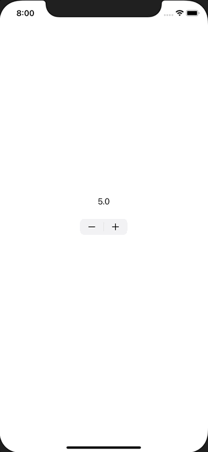

+++
title =  "UIStepperを使って値を増減させる"
url = "2020-12-04"
date = "2020-12-04"
description = "UIStepperを使って値を増減させる"
tags = ["iOS", "Swift", "UIKit"]
categories = ["Swift", "UIKit"]
archives = "2020/12"
+++

<br>

UIStepperを使って値を増減させる方法です。
UIStepperを使うと値を増減させるUIを簡単に実装することができます。



<!-- Google Ads -->


<!-- Amazon Ads -->


<!--more-->

**UIViewController.swift**

```swift
import UIKit

class ViewController: UIViewController {
    private lazy var label = UILabel()

    override func viewDidLoad() {
        super.viewDidLoad()

        view.backgroundColor = .white

        label.textAlignment = .center
        label.text = "5.0"
        label.sizeToFit()
        label.center = CGPoint(x: view.bounds.size.width / 2, y: view.bounds.height / 2 - 50)
        view.addSubview(label)
        
        let stepper = UIStepper()
        stepper.addTarget(self, action: #selector(stepperDidTap(stepper:)), for: .touchUpInside)
        stepper.value = 5
        stepper.minimumValue = 3
        stepper.maximumValue = 8
        stepper.center = view.center
        view.addSubview(stepper)
    }
    
    @objc func stepperDidTap(stepper: UIStepper) {
        label.text = "\(stepper.value)"
        label.sizeToFit()
        label.center = CGPoint(x: view.bounds.size.width / 2, y: view.bounds.height / 2 - 50)
    }
}
```

