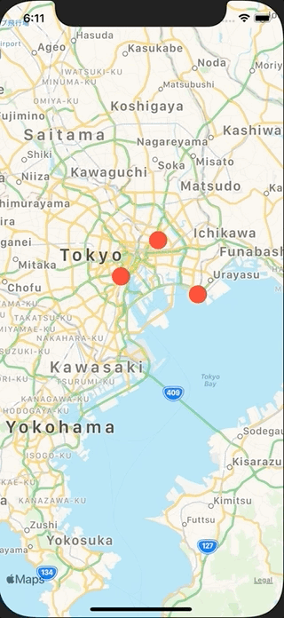

+++
title =  "SwiftUIでMapを表示してアノテーションを表示する"
url = "2020-12-05"
date = "2020-12-05"
description = "SwiftUIでMapを表示してアノテーションを表示する"
tags = ["Swift", "SwiftUI"]
categories = ["Swift", "SwiftUI"]
archives = "2020/12"
+++

<br>

SwiftUIでMapを表示してアノテーションを表示する方法です。
iOS14からSwiftUIでMapKitを使えるようになりました。地図を表示するとかだけならSiwftUIで完結します。



<!-- Google Ads -->


<!-- Amazon Ads -->


<!--more-->

**ContentView.swift**

```swift
import SwiftUI
import MapKit

struct Building: Identifiable {
    let id = UUID()
    let name: String
    let coordinate: CLLocationCoordinate2D
}

struct ContentView: View {
    @State private var region = MKCoordinateRegion(
        center: CLLocationCoordinate2D(latitude: 35.6586, longitude: 139.7454),
        span: MKCoordinateSpan(latitudeDelta: 0.5, longitudeDelta: 0.5))
    
    @State private var userTrackingMode: MapUserTrackingMode = .follow
    @State private var buildings: [Building] = [
        Building(name: "Tokyo Tower", coordinate: .init(latitude: 35.6586, longitude: 139.7454)),
        Building(name: "Tokyo Skytree", coordinate: .init(latitude: 35.7101, longitude: 139.8107)),
        Building(name: "Tokyo Disneyland", coordinate: .init(latitude: 35.6329, longitude: 139.8804))
    ]
    @State var message = ""
    @State var showingAlert = false
    
    var body: some View {
        Map(coordinateRegion: $region,
            interactionModes: MapInteractionModes.all,
            showsUserLocation: true,
            userTrackingMode: $userTrackingMode,
            annotationItems: buildings) { building in
            MapAnnotation(
                coordinate: building.coordinate,
                anchorPoint: CGPoint(x: 0.5, y: 0.5)
            ) {
                Circle()
                    .foregroundColor(Color.red)
                    .frame(width: 24, height: 24)
                    .onTapGesture {
                        message = building.name
                        showingAlert = true
                    }
            }
            }.alert(isPresented: $showingAlert) {
                Alert(
                    title: Text(""),
                    message: Text(message),
                    dismissButton: .cancel(Text("Close")))
            }
        .ignoresSafeArea()
    }
}

struct ContentView_Previews: PreviewProvider {
    static var previews: some View {
        ContentView()
    }
}
```

