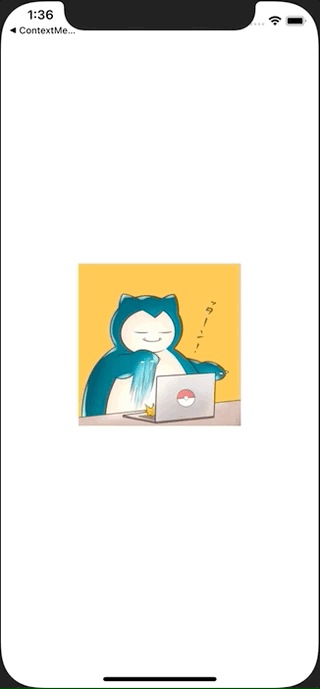

+++
title =  "ImageViewを長押しするとContextMenuを表示する"
url = "2020-12-06"
date = "2020-12-06"
description = "ImageViewを長押しするとContextMenuを表示する"
tags = ["iOS", "Swift", "UIKit"]
categories = ["Swift", "UIKit"]
archives = "2020/12"
+++

<br>

ImageViewを長押しするとUIMenuを表示する方法です。
アイコンが表示されているImageViewを長押しするとContextMenuが表示されます。
少しのコードを書くだけでリッチなUIが実現できて便利です。



<!-- Google Ads -->


<!-- Amazon Ads -->


<!--more-->

**ViewController.swift**

```swift
import UIKit

class ViewController: UIViewController {

    override func viewDidLoad() {
        super.viewDidLoad()
        
        view.backgroundColor = .white

        let imageView = UIImageView()
        imageView.isUserInteractionEnabled = true
        imageView.image = UIImage(named: "icon")
        imageView.frame.size = CGSize(width: 200, height: 200)
        imageView.center = view.center
        view.addSubview(imageView)
        
        let interaction = UIContextMenuInteraction(delegate: self)
        imageView.addInteraction(interaction)
    }
    
    func makeContextMenu() -> UIMenu {
        let fight = UIAction(title: "FIGHT", image: UIImage(systemName: "figure.wave")) { action in
            print("fight")
        }
        
        let bag = UIAction(title: "BAG", image: UIImage(systemName: "bag")) { action in
            print("bag")
        }
        
        let pokemon = UIAction(title: "POKEMON", image: UIImage(systemName: "hare")) { action in
            print("pokemon")
        }
        
        let run = UIAction(title: "RUN", image: UIImage(systemName: "figure.walk")) { action in
            print("run")
        }

        return UIMenu(title: "Menu", children: [fight, bag, pokemon, run])
    }
}

extension ViewController: UIContextMenuInteractionDelegate {
  func contextMenuInteraction(_ interaction: UIContextMenuInteraction, configurationForMenuAtLocation location: CGPoint) -> UIContextMenuConfiguration? {

    return UIContextMenuConfiguration(identifier: nil, previewProvider: nil, actionProvider: { suggestedActions in
        return self.makeContextMenu()
    })
  }
}
```

