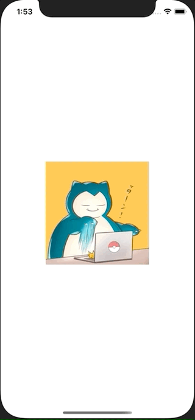

+++
title =  "SwiftUIでImageを長押しするとContextMenuを表示する"
url = "2020-12-07"
date = "2020-12-07"
description = "SwiftUIでImageを長押しするとContextMenuを表示する"
tags = ["Swift", "SwiftUI"]
categories = ["Swift", "SwiftUI"]
archives = "2020/12"
+++

<br>

SwiftUIでImageを長押しするとContextMenuを表示する方法です。
アイコンが表示されているImageを長押しするとContextMenuが表示されます。
少しのコードを書くだけでリッチなUIが実現できて便利です。



<!-- Google Ads -->


<!-- Amazon Ads -->


<!--more-->

**ContentView.swift**

```swift
import SwiftUI

struct ContentView: View {
    var body: some View {
        Image("icon")
            .resizable()
            .frame(width: 200, height: 200)
            .contextMenu {
                Button(action: {
                    print("fight")
                }) {
                    Text("FIGHT")
                    Image(systemName: "figure.wave")
                }
                
                Button(action: {
                    print("bag")
                }) {
                    Text("BAG")
                    Image(systemName: "bag")
                }
                
                Button(action: {
                    print("pokemon")
                }) {
                    Text("POKEMON")
                    Image(systemName: "hare")
                }
                
                Button(action: {
                    print("run")
                }) {
                    Text("RUN")
                    Image(systemName: "figure.walk")
                }
            }
    }
}

struct ContentView_Previews: PreviewProvider {
    static var previews: some View {
        ContentView()
    }
}
```

