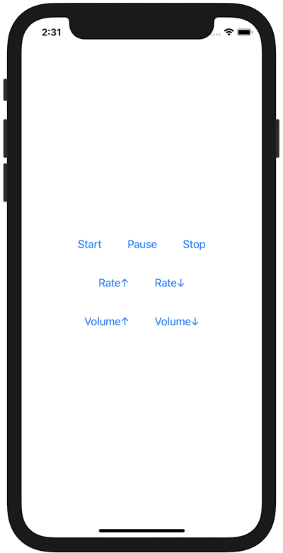

+++
title =  "AVAudioPlayerを使って音楽の再生、一時停止、停止、ボリューム変更、再生速度変更を行う"
url = "2020-12-08"
date = "2020-12-08"
description = "AVAudioPlayerを使って音楽の再生、一時停止、停止、ボリューム変更、再生速度変更を行う"
tags = ["Swift", "SwiftUI"]
categories = ["Swift", "SwiftUI"]
archives = "2020/12"
+++

<br>

AVAudioPlayerを使って音楽の再生、一時停止、停止、ボリューム変更、再生速度変更を行う方法です。
AVAudioPlayerを使うと簡単に音楽の再生などに関することするができます。
ただ AVAudioPlayer にできることは限られており、より複雑な操作をするためには AVAudioPlayerNode を使う必要があります。



<!-- Google Ads -->


<!-- Amazon Ads -->


<!--more-->

**ContentView.swift**

```swift
import SwiftUI
import AVFoundation

struct ContentView: View {
    @State var audioPlayer: AVAudioPlayer!
    @State var isPause = false
    
    var body: some View {
        VStack {
            HStack {
                Button("Start") {
                    guard let url = Bundle.main.url(forResource: "autumn-leaves", withExtension: "mp3") else { return }
                    guard let data = try? Data(contentsOf: url) else { return }
                    audioPlayer = try? AVAudioPlayer(data: data)
                    audioPlayer.enableRate = true
                    audioPlayer?.play()
                }.padding()
                
                Button("Pause") {
                    if isPause {
                        audioPlayer.play()
                    } else {
                        audioPlayer.pause()
                    }
                    isPause.toggle()
                }.padding()
                
                Button("Stop") {
                    audioPlayer.stop()
                }.padding()
            }
            
            HStack {
                Button("Rate↑") {
                    audioPlayer.rate += 0.1
                }.padding()
                
                Button("Rate↓") {
                    audioPlayer.rate -= 0.1
                }.padding()
            }
            
            HStack {
                Button("Volume↑") {
                    audioPlayer.volume += 0.2
                }.padding()
                
                Button("Volume↓") {
                    audioPlayer.volume -= 0.2
                }.padding()
            }
        }
    }
}

struct ContentView_Previews: PreviewProvider {
    static var previews: some View {
        ContentView()
    }
}
```

