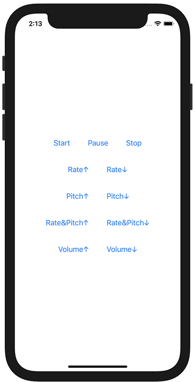

+++
title =  "AVAudioPlayerNodeを使って音楽の再生、一時停止、再生速度変更、ピッチ変更、ボリューム変更を行う"
url = "2020-12-09"
date = "2020-12-09"
description = "AVAudioPlayerNodeを使って音楽の再生、一時停止、再生速度変更、ピッチ変更、ボリューム変更を行う"
tags = ["Swift", "SwiftUI"]
categories = ["Swift", "SwiftUI"]
archives = "2020/12"
+++

<br>

AVAudioPlayerNodeを使って音楽の再生、一時停止、再生速度変更、ピッチ変更、ボリューム変更を行う方法です。
AVAudioPlayerNodeはAVAudioPlayerではできないようなことができます。
たとえばピッチの変更などAVAudioPlayerでは実現することはできないので、AVAudioPlayerNodeを使う必要があります。



<!-- Google Ads -->


<!-- Amazon Ads -->


<!--more-->

**ContentView.swift**

```swift
import SwiftUI
import AVFoundation

struct ContentView: View {
    @State var audioPlayerNode = AVAudioPlayerNode()
    @State var audioEngine = AVAudioEngine()
    @State var speedControl = AVAudioUnitVarispeed()
    @State var pitchControl = AVAudioUnitTimePitch()
    @State var isPause = false

    var body: some View {

        VStack {
            HStack {
                Button("Start") {
                    guard let url = Bundle.main.url(forResource: "autumn-leaves", withExtension: "mp3") else { return }
                    guard let file = try? AVAudioFile(forReading: url) else { return }

                    audioPlayerNode = AVAudioPlayerNode()

                    audioEngine.attach(audioPlayerNode)
                    audioEngine.attach(pitchControl)
                    audioEngine.attach(speedControl)

                    audioEngine.connect(audioPlayerNode, to: speedControl, format: nil)
                    audioEngine.connect(speedControl, to: pitchControl, format: nil)
                    audioEngine.connect(pitchControl, to: audioEngine.mainMixerNode, format: nil)
                    audioPlayerNode.scheduleFile(file, at: nil)

                    try? audioEngine.start()
                    audioPlayerNode.play()
                }.padding()

                Button("Pause") {
                    if isPause {
                        audioPlayerNode.play()
                    } else {
                        audioPlayerNode.pause()
                    }
                    isPause.toggle()
                }.padding()

                Button("Stop") {
                    audioPlayerNode.volume = 0
                }.padding()
            }

            HStack {
                Button("Rate↑") {
                    pitchControl.rate += 0.1
                }.padding()

                Button("Rate↓") {
                    pitchControl.rate -= 0.1
                }.padding()
            }

            HStack {
                Button("Pitch↑") {
                    pitchControl.pitch += 50
                }.padding()

                Button("Pitch↓") {
                    pitchControl.pitch -= 50
                }.padding()
            }

            HStack {
                Button("Rate&Pitch↑") {
                    speedControl.rate += 0.1
                }.padding()

                Button("Rate&Pitch↓") {
                    speedControl.rate -= 0.1
                }.padding()
            }

            HStack {
                Button("Volume↑") {
                    audioPlayerNode.volume += 0.2
                }.padding()

                Button("Volume↓") {
                    audioPlayerNode.volume -= 0.2
                }.padding()
            }
        }
    }
}

struct ContentView_Previews: PreviewProvider {
    static var previews: some View {
        ContentView()
    }
}
```

