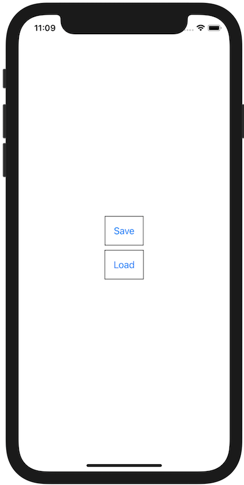

+++
title =  "Swiftで文字列を圧縮して保存し、そのデータを読み取る"
url = "2021-01-01"
date = "2021-01-01"
description = "Swiftで文字列を圧縮して保存し、そのデータを読み取る"
tags = ["iOS", "Swift", "SwiftUI"]
categories = ["iOS", "SwiftUI"]
archives = "2020/01"
+++

<br>

Swiftで文字列を圧縮して保存し、そのデータを読み取る方法です。
zlib というアルゴリズムで文字列を圧縮し、保存しています。
Java の `Deflater`, `Inflater` に相当する方法ですが、header、チェックサムの情報が抜けている生のデータが保存されるので気をつける必要があります。




```
static void saveCompressedData() {
    try {
        // Encode a String into bytes
        String text = "hello";
        byte[] data = text.getBytes(StandardCharsets.UTF_8);

        // Compress the bytes
        ByteArrayOutputStream byteArrayOutputStream = new ByteArrayOutputStream();
        DeflaterOutputStream outputStream = new DeflaterOutputStream(byteArrayOutputStream);
        outputStream.write(data);
        outputStream.finish()
        String path = "/Users/kabigon/Desktop/data.data";
        try (FileOutputStream fos = new FileOutputStream(path)) {
            fos.write(byteArrayOutputStream.toByteArray());
        }

        System.out.println("----------------------");
        System.out.println("Save Completed!!");
        System.out.println(String.format("Path: %s", path));
        System.out.println("----------------------");
    } catch (Exception e) {
        e.printStackTrace();
    }
}
```


```
----------------------
Java: [120, -100, -53, 72, -51, -55, -55, 7, 0, 6, 44, 2, 21]
Swift: [-53, 72, -51, -55, -55, 7, 0]
----------------------
```


参考: [NSData > compressed(using:)](https://developer.apple.com/documentation/foundation/nsdata/3174960-compressed)

<!-- Google Ads -->


<!-- Amazon Ads -->


<!--more-->

**ContentView.swift**

```swift
import SwiftUI

struct ContentView: View {
    var body: some View {
        VStack {
            Button(action: {
                saveCompressedData()
            }, label: {
                Text("Save")
                    .padding()
                    .border(Color.black, width: 1)
            })
            
            Button(action: {
                loadCompressedData()
            }, label: {
                Text("Load")
                    .padding()
                    .border(Color.black, width: 1)
            })
        }
    }
    
    func saveCompressedData() {
        let text = "hello"
        guard let data: Data = text.data(using: .utf8) else {
            fatalError("Fail to Decode Text")
        }
        
        let nsData: NSData = NSData(data: data)
        guard let compressedData: Data = try? nsData.compressed(using: .zlib) as Data else {
            fatalError("Fail to Compress Data")
        }
        
        guard let documentUrl = FileManager.default.urls( for: .documentDirectory, in: .userDomainMask ).first else {
            fatalError("Fail to Get Document Url")
        }
        let path = documentUrl.appendingPathComponent( "data.dat" )
        do {
            try compressedData.write(to: path)
        } catch {
            fatalError("Fail to Save File, error: \(error.localizedDescription)")
        }
        
        print("----------------------")
        print("Save Completed!!")
        print("Path: \(path)")
        print("----------------------")
    }

    func loadCompressedData() {
        guard let documentUrl = FileManager.default.urls( for: .documentDirectory, in: .userDomainMask ).first else {
            fatalError("Fail to Get Document Url")
        }
        let path = documentUrl.appendingPathComponent( "data.dat" )
        
        guard let compressedData = try? Data(contentsOf: path) else {
            fatalError("Fail to Load File")
        }
        
        let compressedNSData = NSData(data: compressedData)
        guard let data: Data = try? compressedNSData.decompressed(using: .zlib) as Data else {
            fatalError("Fail to Decompress Data")
        }
        
        guard let text = String(data: data, encoding: .utf8) else {
            fatalError("Fail to Encoading Data")
        }
        print("----------------------")
        print("Load Completed!!")
        print("Path: \(path)")
        print("Text: \(text)")
        print("----------------------")
    }
}

struct ContentView_Previews: PreviewProvider {
    static var previews: some View {
        ContentView()
    }
}
```

