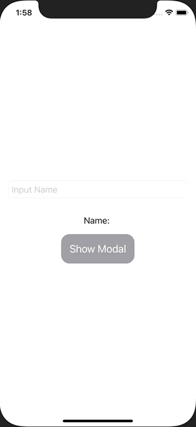

+++
title =  "SwiftUIでモーダルを表示する時に値を渡す"
url = "2021-02-01"
date = "2021-02-01"
description = "SwiftUIでモーダルを表示する時に値を渡す"
tags = ["iOS", "Swift", "SwiftUI"]
categories = ["iOS", "SwiftUI"]
archives = "2020/02"
+++

<br>

SwiftUIでモーダルを表示する時に値を渡す方法です。
TextFieldでname変数に文字列を入力します。その入力した文字列をPokemonView に渡して表示しています。



<!-- Google Ads -->


<!-- Amazon Ads -->


<!--more-->

**ContentView.swift**

```swift
import SwiftUI

struct ContentView: View {
    @State var name = ""
    @State var showingModal = false
    var body: some View {
        VStack(spacing: 16) {
            TextField("Input Name", text: $name)
                .textFieldStyle(RoundedBorderTextFieldStyle())
                .padding()
            Text("Name: \(name)")

            Button {
                showingModal = true
            } label: {
                Text("Show Modal")
                    .font(Font.system(size: 20))
                    .foregroundColor(Color.white)
                    .padding(16)
                    .background(Color.gray)
                    .cornerRadius(16)
            }
            .sheet(isPresented: $showingModal) {
                PokemonView(pokemonName: name)
            }
        }
    }
}

struct PokemonView: View {
    let pokemonName: String
    var body: some View {
        Text("Name: \(pokemonName)")
    }
}


struct ContentView_Previews: PreviewProvider {
    static var previews: some View {
        ContentView()
    }
}
```

