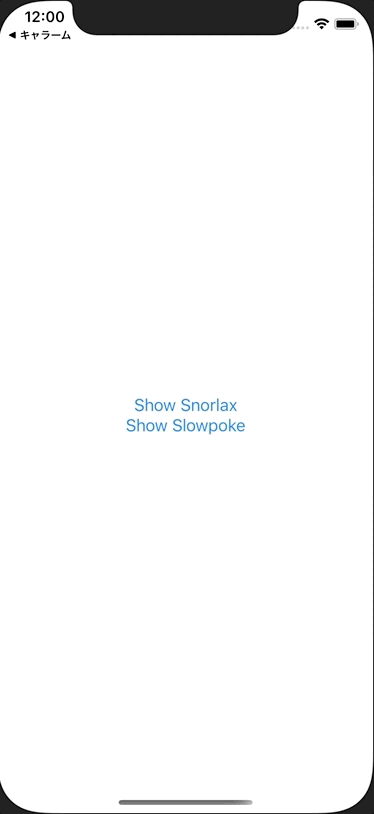

+++
title =  "SwiftUIで複数のモーダルをEnumで出し分ける"
url = "2021-02-03"
date = "2021-02-03"
description = "SwiftUIで複数のモーダルをEnumで出し分ける"
tags = ["iOS", "Swift", "SwiftUI"]
categories = ["iOS", "SwiftUI"]
archives = "2020/02"
+++

<br>



SwiftUIで複数のモーダルをEnumで出し分ける方法です。
enumを使うことでスッキリと書くことができました。
iOS13では使えないので気をつけてください。

<!-- Google Ads -->


<!-- Amazon Ads -->


<!--more-->

**ContentView.swift**

```swift
import SwiftUI

struct ContentView: View {
    @State var sheetItem: SheetItem?
    var body: some View {
        VStack {
            Button(action: {
                sheetItem = .snorlax
            }) {
                Text("Show Snorlax")
            }
            
            Button(action: {
                sheetItem = .slowpoke
            }) {
                Text("Show Slowpoke")
            }
        }
        .sheet(item: $sheetItem) { item in
            switch item {
            case .snorlax:
                SnorlaxView()
            case .slowpoke:
                SlowpokeView()
            }
        }
    }
}

enum SheetItem: Identifiable {
    case snorlax
    case slowpoke
    var id: Int {
        hashValue
    }
}

struct SnorlaxView: View {
    var body: some View {
        Image("snorlax")
            .resizable()
            .frame(width: 150, height: 150)
            .scaledToFit()
    }
}

struct SlowpokeView: View {
    var body: some View {
        Image("slowpoke")
            .resizable()
            .frame(width: 150, height: 150)
            .scaledToFit()
    }
}

struct ContentView_Previews: PreviewProvider {
    static var previews: some View {
        ContentView()
    }
}
```

