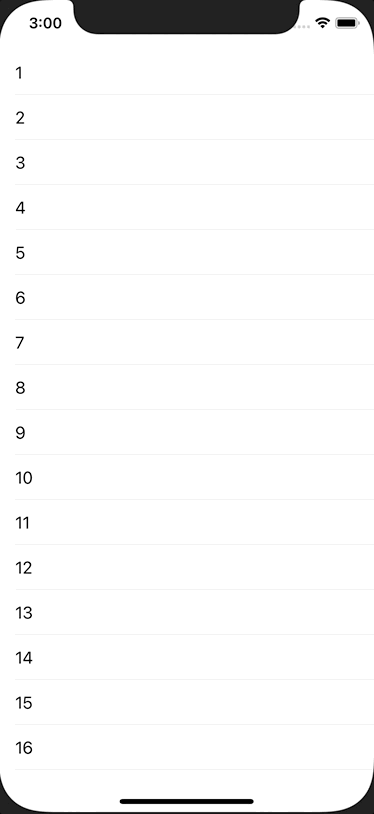

+++
title =  "TableViewのセルを長押しでContextMenuを表示する"
url = "2021-02-04"
date = "2021-02-04"
description = "TableViewのセルを長押しでContextMenuを表示する"
tags = ["iOS", "Swift", "UIKit"]
categories = ["iOS", "Swift"]
archives = "2020/02"
+++

<br>



TableViewのセルを長押しでContextMenuを表示する方法です。
手軽にメニューが表示することができ、とても使い勝手が良いので積極的に使っていきたいです。

<!-- Google Ads -->


<!-- Amazon Ads -->


<!--more-->

**ViewController.swift**

```swift
import UIKit

class ViewController: UIViewController {
    private lazy var tableView = UITableView()
    
    override func viewDidLoad() {
        super.viewDidLoad()
        
        view.backgroundColor = .white
        
        tableView.frame = view.bounds
        tableView.register(UITableViewCell.self, forCellReuseIdentifier: NSStringFromClass(UITableViewCell.self))
        tableView.dataSource = self
        tableView.delegate = self
        view.addSubview(tableView)
    }
    
    func makeContextMenu() -> UIMenu {
        let fight = UIAction(title: "FIGHT", image: UIImage(systemName: "figure.wave")) { action in
            print("fight")
        }
        
        let bag = UIAction(title: "BAG", image: UIImage(systemName: "bag")) { action in
            print("bag")
        }
        
        let pokemon = UIAction(title: "POKEMON", image: UIImage(systemName: "hare")) { action in
            print("pokemon")
        }
        
        let run = UIAction(title: "RUN", image: UIImage(systemName: "figure.walk")) { action in
            print("run")
        }
        
        return UIMenu(title: "Menu", children: [fight, bag, pokemon, run])
    }
}

extension ViewController: UITableViewDataSource {
    func tableView(_ tableView: UITableView, numberOfRowsInSection section: Int) -> Int {
        return 16
    }
    
    func tableView(_ tableView: UITableView, cellForRowAt indexPath: IndexPath) -> UITableViewCell {
        let cell = tableView.dequeueReusableCell(withIdentifier: NSStringFromClass(UITableViewCell.self))!
        cell.textLabel?.text = "\(indexPath.row + 1)"
        return cell
    }
}

extension ViewController: UITableViewDelegate {
    func tableView(_ tableView: UITableView, didSelectRowAt indexPath: IndexPath) {
        print("CellTapped, index=\(indexPath.row)")
        tableView.deselectRow(at: indexPath, animated: true)
    }
    
    func tableView(_ tableView: UITableView, contextMenuConfigurationForRowAt indexPath: IndexPath, point: CGPoint) -> UIContextMenuConfiguration? {
        return UIContextMenuConfiguration(identifier: nil, previewProvider: nil, actionProvider: { suggestedActions in
            return self.makeContextMenu()
        })
    }
}
```

