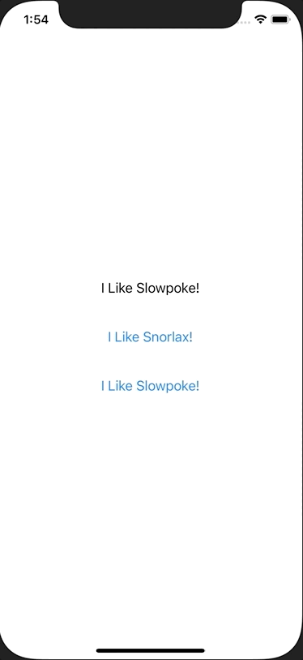
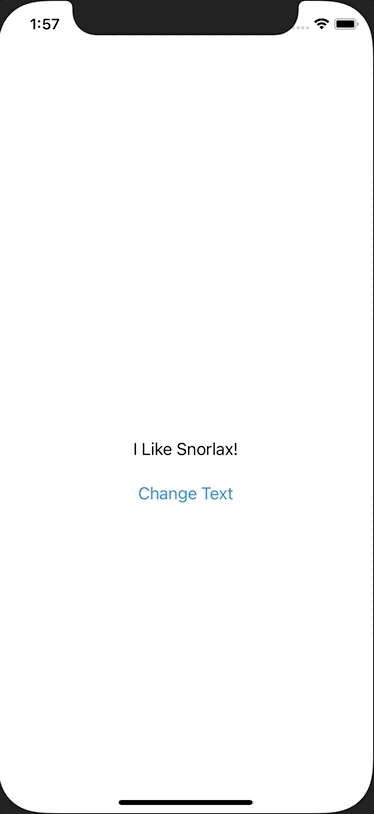

+++
title =  "@Stateと@Bindingの使い分け"
url = "2021-02-05"
date = "2021-02-05"
description = "@Stateと@Bindingの使い分け"
tags = ["iOS", "Swift", "SwiftUI"]
categories = ["iOS", "SwiftUI"]
archives = "2020/02"
+++

<br>

@Stateと@Bindingの使い分けについです。

@State のついた変数を変更することでViewにその変更が反映されます。
以下の例ではボタンを押すことで 変数textの値を変えています。
変数textの値を変えることでその変更が反映され、文字列が変わります。



<!-- Google Ads -->


<!--more-->

**ContentView.swift**

```swift
import SwiftUI

struct ContentView: View {
    @State var text: String = "I Like Slowple!"
    
    var body: some View {
        VStack {
            Text(text)
                .padding()
            
            Button(action: {
                text = "I Like Snorlax!"
            }, label: {
                Text("I Like Snorlax!")
            })
            .padding()
            
            Button(action: {
                text = "I Like Slowple!"
            }, label: {
                Text("I Like Slowple!")
            })
            .padding()
        }
    }
}

struct ContentView_Previews: PreviewProvider {
    static var previews: some View {
        ContentView()
    }
}

```


<!-- Amazon Ads -->


@Binding は親のViewのプロパティを子のViewで変えたい時に使います。
ContentViewでは変数textの値を表示しています。
ChangeTextボタンを押してSecondViewに遷移し、そこで値を変えると親である ContentView のプロパティも変更され、画面にその変更が反映されています。



**ContentView.swift**

```swift
import SwiftUI

struct ContentView: View {
    @State var text: String = "I Like Slowpoke!"
    
    var body: some View {
        NavigationView {
            VStack {
                Text(text)
                    .padding()
                
                NavigationLink(destination: SecondView(text: $text)) {
                    Text("Change Text")
                }
            }
        }
    }
}

struct SecondView: View {
    @Binding var text: String
    
    var body: some View {
        VStack {
            Button(action: {
                text = "I Like Snorlax!"
            }, label: {
                Text("I Like Snorlax!")
            })
            .padding()
            
            Button(action: {
                text = "I Like Slowpoke!"
            }, label: {
                Text("I Like Slowpoke!")
            })
            .padding()
        }
    }
}

struct ContentView_Previews: PreviewProvider {
    static var previews: some View {
        ContentView()
    }
}

```


