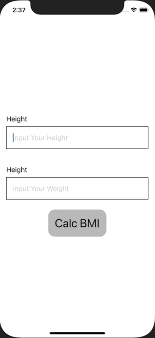

+++
title =  "SwiftUIでBMIを計算し、結果を別のViewで表示する"
url = "2021-02-06"
date = "2021-02-06"
description = "SwiftUIでBMIを計算し、結果を別のViewで表示する"
tags = ["iOS", "Swift", "SwiftUI"]
categories = ["iOS", "SwiftUI"]
archives = "2020/02"
+++

<br>

SwiftUIでBMIを計算し、結果を別のViewで表示する方法です。
身長と体重を入力し、計算ボタンを押すことで計算したBMIを表示しています。



<!-- Google Ads -->


<!-- Amazon Ads -->


<!--more-->

**ContentView.swift**

```swift
import SwiftUI

struct ContentView: View {
    @State var height: String = ""
    @State var weight: String = ""
    @State var bmi: Double = 0
    @State var showingSheet = false
    
    var body: some View {
        VStack {
            VStack(alignment: .leading) {
                Text("Height")
                TextField("Input Your Height", text: $height)
                    .padding()
                    .border(Color.black, width: 1)
            }
            .padding()
            
            VStack(alignment: .leading) {
                Text("Height")
                TextField("Input Your Weight", text: $weight)
                    .padding()
                    .border(Color.black, width: 1)
            }
            .padding()
            
            Button(action: {
                guard let height = Double(self.height),
                      let weight = Double(self.weight) else {
                    print("Fail to Calc BMI")
                    return
                }
                
                // Calc BMI
                bmi = weight / (height / 100) / (height / 100)
                
                // Show Sheet
                self.showingSheet = true
            }, label: {
                Text("Calc BMI")
                    .font(.title)
                    .foregroundColor(Color.black)
                    .padding()
                    .background(Color(UIColor.lightGray))
                    .cornerRadius(16)
            })
        }
        .sheet(isPresented: $showingSheet, content: {
            ResultView(bmi: $bmi)
        })
    }
}

struct ResultView: View {
    @Binding var bmi: Double
    var body: some View {
        VStack {
            Text("BMI: \(bmi)")
            
            if bmi < 18.5 {
                Text("You are thin")
                Image("bellsprout")
                    .resizable()
                    .frame(width: 200, height: 200)
            } else if bmi > 25 {
                Text("You are fat")
                Image("snorlax")
                    .resizable()
                    .frame(width: 200, height: 200)
            } else {
                Text("You are healthy")
                Image("pikachu")
                    .resizable()
                    .frame(width: 200, height: 200)
            }
        }
    }
}

struct ContentView_Previews: PreviewProvider {
    static var previews: some View {
        ContentView()
    }
}
```


ただ上の例では bmi と showingSheet の二つのプロパティが必要です。
新しく ContentActionSheetを定義する必要がありますが、以下の方法だとプロパティの数を減らしたりenumの種類によってシートの出し分けをすることができます。


<!-- Amazon Ads -->


**ContentView.swift**

```swift
import SwiftUI

struct ContentView: View {
    @State var height: String = ""
    @State var weight: String = ""
    @State var sheet: ContentViewSheet?
    
    var body: some View {
        VStack {
            VStack(alignment: .leading) {
                Text("Height")
                TextField("Input Your Height", text: $height)
                    .padding()
                    .border(Color.black, width: 1)
            }
            .padding()
            
            VStack(alignment: .leading) {
                Text("Height")
                TextField("Input Your Weight", text: $weight)
                    .padding()
                    .border(Color.black, width: 1)
            }
            .padding()
            
            Button(action: {
                guard let height = Double(self.height),
                      let weight = Double(self.weight) else {
                    print("Fail to Calc BMI")
                    return
                }
                
                // Calc BMI
                let bmi = weight / (height / 100) / (height / 100)
                sheet = .bmi(bmi)
            }, label: {
                Text("Calc BMI")
                    .font(.title)
                    .foregroundColor(Color.black)
                    .padding()
                    .background(Color(UIColor.lightGray))
                    .cornerRadius(16)
            })
        }
        .sheet(item: $sheet) { item in
            switch item {
            case let .bmi(bmi):
                ResultView(bmi: bmi)
            }
        }
    }
}

enum ContentViewSheet: Identifiable {
    case bmi(Double)
    
    var id: Double {
        switch self {
        case let .bmi(bmi):
            return bmi
        }
    }
}

struct ResultView: View {
    let bmi: Double
    var body: some View {
        VStack {
            Text("BMI: \(bmi)")
            
            if bmi < 18.5 {
                Text("You are thin")
                Image("bellsprout")
                    .resizable()
                    .frame(width: 200, height: 200)
            } else if bmi > 25 {
                Text("You are fat")
                Image("snorlax")
                    .resizable()
                    .frame(width: 200, height: 200)
            } else {
                Text("You are healthy")
                Image("pikachu")
                    .resizable()
                    .frame(width: 200, height: 200)
            }
        }
    }
}

struct ContentView_Previews: PreviewProvider {
    static var previews: some View {
        ContentView()
    }
}

```


