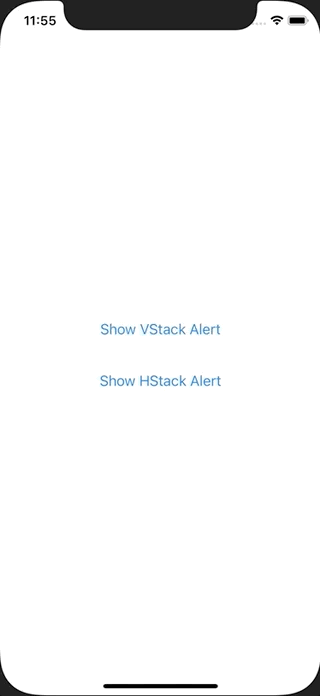

+++
title =  "SwiftUIでアラートを入れ子にして使うことができない"
url = "2021-02-09"
date = "2021-02-09"
description = "SwiftUIでアラートを入れ子にして使うことができない"
tags = ["iOS", "Swift", "SwiftUI"]
categories = ["iOS", "SwiftUI"]
archives = "2020/02"
+++

<br>

SwiftUIでアラートを入れ子にして使うことができなかったのでそのメモです。
以下のコードの様に HStack の中に VStack を入れ、それぞれに .alert を使うと内側の .alert がうまく動かなかったです。
.alert は入れ子にしない方が良さそうです。




<!-- Google Ads -->


<!-- Amazon Ads -->


<!--more-->

**ContentView.swift**

```swift
import SwiftUI

struct ContentView: View {
    @State var showingVStackAlert = false
    @State var showingHStackAlert = false
    var body: some View {
        HStack {
            VStack {
                Button {
                    showingVStackAlert = true
                } label: {
                    Text("Show VStack Alert")
                }.padding()
                
                Button {
                    showingHStackAlert = true

                } label: {
                    Text("Show HStack Alert")
                }.padding()
            }
            .alert(isPresented: $showingVStackAlert) { () -> Alert in
                Alert(title: Text("VStack"), message: Text("This is VStack Alert"), dismissButton: .cancel())
            }
        }
        .alert(isPresented: $showingHStackAlert) { () -> Alert in
            Alert(title: Text("HStack"), message: Text("This is HStack Alert"), dismissButton: .cancel())
        }
    }
}

struct ContentView_Previews: PreviewProvider {
    static var previews: some View {
        ContentView()
    }
}
```


