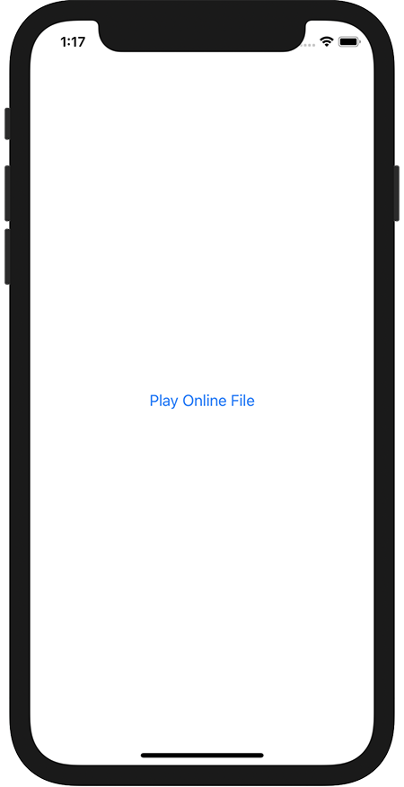

+++
title =  "Swiftでオンライン上のファイルを再生する"
url = "2021-02-10"
date = "2021-02-10"
description = "Swiftでオンライン上のファイルを再生する"
tags = ["iOS", "Swift", "SwiftUI"]
categories = ["iOS", "SwiftUI"]
archives = "2020/02"
+++

<br>

Swiftでオンライン上のファイルを再生する方法です。
簡単に実装できました。ただエラーハンドリングができないのが弱点です。




<!-- Google Ads -->


<!-- Amazon Ads -->


<!--more-->

**ContentView.swift**

```swift
import SwiftUI
import AVFoundation

struct ContentView: View {
    @State var avPlayer: AVPlayer?
    var body: some View {
        VStack {
            Button {
                playOnlineFile()
            } label: {
                Text("Play Online File")
            }
        }
    }
    
    func playOnlineFile() {
        let url = URL(string: "https://swiswiswift.com/2021-02-10/self-introduction.caf")!
        let playerItem = AVPlayerItem(url: url)
        avPlayer = AVPlayer(playerItem: playerItem)
        avPlayer?.play()
    }
}

struct ContentView_Previews: PreviewProvider {
    static var previews: some View {
        ContentView()
    }
}

```


