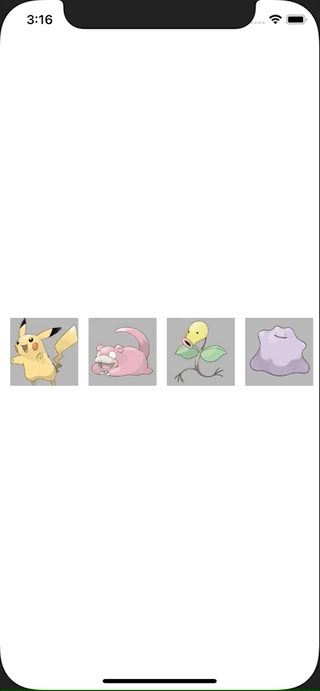

+++
title =  "SwiftUIでViewを横スクロールで表示する"
url = "2021-03-02"
date = "2021-03-02"
description = "SwiftUIでViewを横スクロールで表示する"
tags = ["iOS", "Swift", "SwiftUI"]
categories = ["iOS", "SwiftUI"]
archives = "2020/03"
+++

<br>

SwiftUIでViewを横スクロールで表示する方法です。
SwiftUIだと簡単に実装できて良いですね！！



<!-- Google Ads -->


<!-- Amazon Ads -->


<!--more-->

**ContentView.swift**

```swift
import SwiftUI

struct ContentView: View {
    @State var pokemons: [Pokemon] = [
            Pokemon(imageName: "pikachu"),
            Pokemon(imageName: "slowpoke"),
            Pokemon(imageName: "bellsprout"),
            Pokemon(imageName: "ditto"),
            Pokemon(imageName: "snorlax"),
            Pokemon(imageName: "eevee"),
            Pokemon(imageName: "magikarp"),
        ]
    
    var body: some View {
        ScrollView(.horizontal, showsIndicators: false) {
            LazyHStack(spacing: 12) {
                ForEach(pokemons) { pokemon in
                    Image(pokemon.imageName)
                        .resizable()
                        .frame(width: 80, height: 80)
                        .background(Color(UIColor.lightGray))
                }
            }
            .padding(.horizontal, 12)
        }
        .frame(height: 80)
    }
}

struct Pokemon: Identifiable {
    var id: String {
        return imageName
    }
    let imageName: String
}

struct ContentView_Previews: PreviewProvider {
    static var previews: some View {
        ContentView()
    }
}
```


