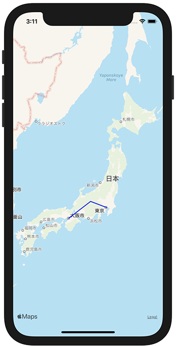

+++
title =  "SwiftでMKMapViewに線を引く"
url = "2021-03-05"
date = "2021-03-05"
description = "SwiftでMKMapViewに線を引く"
tags = ["iOS", "Swift", "UIKit"]
categories = ["iOS", "Swift", "UIKit"]
archives = "2020/03"
+++

<br>

SwiftでMKMapViewに線を引く方法です。
以下の例では大阪、松本、東京で線を引いています。



<!-- Google Ads -->


<!-- Amazon Ads -->


<!--more-->

**ViewController.swift**

```swift
import UIKit
import MapKit

class ViewController: UIViewController {
    
    override func viewDidLoad() {
        super.viewDidLoad()
        
        let mapView = MKMapView()
        mapView.frame = view.bounds
        mapView.delegate = self
        view.addSubview(mapView)
        
        let coordinates: [CLLocationCoordinate2D]  = [
            CLLocationCoordinate2D(latitude: 35.6804, longitude: 139.7690),
            CLLocationCoordinate2D(latitude: 36.2380, longitude: 137.9720),
            CLLocationCoordinate2D(latitude: 34.6937, longitude: 135.5023),
        ]
        let polyLine = MKPolyline(coordinates: coordinates, count: coordinates.count)
        mapView.addOverlay(polyLine)
    }
}

extension ViewController: MKMapViewDelegate {
    func mapView(_ mapView: MKMapView, rendererFor overlay: MKOverlay) -> MKOverlayRenderer {
        if let polyline = overlay as? MKPolyline {
            let polylineRenderer = MKPolylineRenderer(polyline: polyline)
            polylineRenderer.strokeColor = .blue
            polylineRenderer.lineWidth = 2.0
            return polylineRenderer
        }
        return MKOverlayRenderer()
    }
}


```


