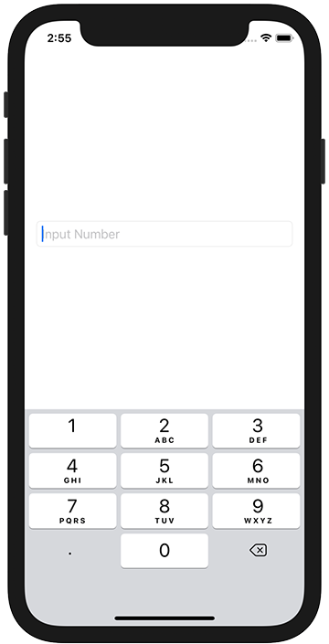

+++
title =  "SwiftUIのTextFieldで表示するキーボードを指定する"
url = "2021-03-07"
date = "2021-03-07"
description = "SwiftUIのTextFieldで表示するキーボードを指定する"
tags = ["iOS", "Swift", "SwiftUI"]
categories = ["iOS", "SwiftUI"]
archives = "2020/03"
+++

<br>

SwiftUIのTextFieldで表示するキーボードを指定する方法です。
`keyboardType` を指定することで表示するキーボードの種類を設定することができます。



<!-- Google Ads -->


<!-- Amazon Ads -->


<!--more-->

**ContentView.swift**

```swift
import SwiftUI

struct ContentView: View {
    @State var numberString = ""
    var body: some View {
        TextField("Input Number", text: $numberString)
            .keyboardType(.decimalPad)
            .textFieldStyle(RoundedBorderTextFieldStyle())
            .padding()
    }
}

struct ContentView_Previews: PreviewProvider {
    static var previews: some View {
        ContentView()
    }
}
```


