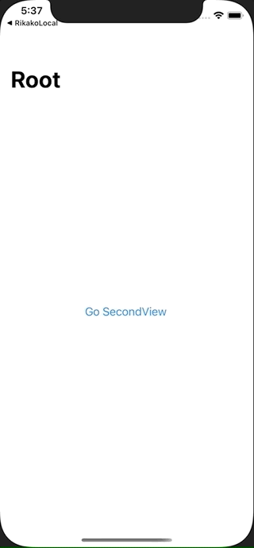

+++
title =  "SwiftUIで初めの画面に遷移する（popToRootViewController）"
url = "2021-03-09"
date = "2021-03-09"
description = "SwiftUIで初めの画面に遷移する（popToRootViewController）"
tags = ["iOS", "Swift", "SwiftUI"]
categories = ["iOS", "SwiftUI"]
archives = "2020/03"
+++

<br>

SwiftUIで初めの画面に遷移する（popToRootViewController）方法です。
`isDetailLink` がポイントです。



<!-- Google Ads -->


<!-- Amazon Ads -->


<!--more-->

**ContentView.swift**

```swift
import SwiftUI

struct ContentView: View {
    @State var isActive : Bool = false
    var body: some View {
        NavigationView {
            NavigationLink(
                destination: SecondView(rootIsActive: $isActive),
                isActive: $isActive
            ) {
                Text("Go SecondView")
            }
            .isDetailLink(false)
            .navigationBarTitle("Root")
        }
    }
}

struct SecondView: View {
    @Binding var rootIsActive : Bool
    var body: some View {
        NavigationLink(destination: ThirdView(shouldPopToRootView: self.$rootIsActive)) {
            Text("Go ThirdView")
        }
        .isDetailLink(false)
        .navigationBarTitle("SecondView")
    }
}

struct ThirdView: View {
    @Binding var shouldPopToRootView : Bool
    var body: some View {
        VStack {
            Button (action: { shouldPopToRootView = false } ){
                Text("Pop to RootView")
            }
        }.navigationBarTitle("ThirdView")
    }
}

struct ContentView_Previews: PreviewProvider {
    static var previews: some View {
        ContentView()
    }
}
```


