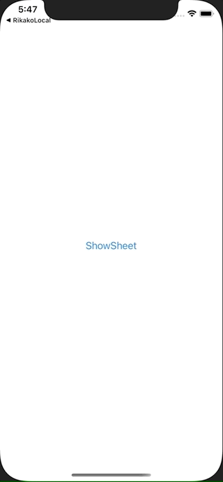

+++
title =  "SwiftUIでシートを表示し、プッシュ遷移後にシートを閉じる"
url = "2021-03-10"
date = "2021-03-10"
description = "SwiftUIでシートを表示し、プッシュ遷移後にシートを閉じる"
tags = ["iOS", "Swift", "SwiftUI"]
categories = ["iOS", "SwiftUI"]
archives = "2020/03"
+++

<br>

SwiftUIでシートを表示し、プッシュ遷移後にシートを閉じる方法です。
遷移後のシートでもisPresentedの情報を保持するのがポイントです。



<!-- Google Ads -->


<!-- Amazon Ads -->


<!--more-->

**ContentView.swift**

```swift
import SwiftUI

struct ContentView: View {
    @State var showingSheet : Bool = false
    var body: some View {
        Button(
            action: { showingSheet = true },
            label: {
                Text("ShowSheet")
            })
            .sheet(isPresented: $showingSheet){
                FirstSheet(showingSheet: $showingSheet)
            }
    }
}

struct FirstSheet: View {
    @Binding var showingSheet : Bool
    var body: some View {
        NavigationView {
            NavigationLink(
                destination: SecondSheet(showingSheet: $showingSheet),
                label: {
                    Text("Go to SecondSheet")
                }
            )
            .navigationTitle("FirstSheet")
        }
    }
}

struct SecondSheet: View {
    @Binding var showingSheet : Bool
    var body: some View {
        VStack {
            Button(action: {
                showingSheet = false
            } ){
                Text("Close Sheet")
            }
        }.navigationBarTitle("SecondSheet")
    }
}

struct ContentView_Previews: PreviewProvider {
    static var previews: some View {
        ContentView()
    }
}
```


