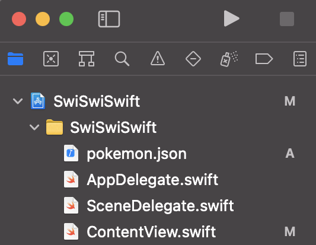
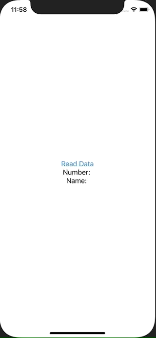

+++
title =  "Swiftでプロジェクトの中に含まれるJSONファイルを読み込む"
url = "2021-04-01"
date = "2021-04-01"
description = "Swiftでプロジェクトの中に含まれるJSONファイルを読み込む"
tags = ["iOS", "Swift", "SwiftUI"]
categories = ["iOS", "Swift"]
archives = "2021/04"
+++

<br>

Swiftでプロジェクトの中に含まれるJSONファイルを読み込む方法です。
まずプロジェクトに読み込みたい JSON ファイルを追加します。
画像のように追加します。



追加した JSON ファイルの中身は以下です。

```
{
    "number": 143,
    "name": "Snorlax"
}
```

次に追加した JSON ファイルをデコードするためのstructをJSON の中身に合わせて作成します。
ボタンを押すとプロジェクト中の pokemon.json を読み込み、Pokemon構造体にデコードし、State を更新させて文字列を表示しています。



<!-- Google Ads -->


<!-- Amazon Ads -->


<!--more-->

**ContentView.swift**

```swift
import SwiftUI

struct Pokemon: Decodable {
    let number: Int
    let name: String
}

struct ContentView: View {
    @State var number: String = ""
    @State var name: String = ""
    
    var body: some View {
        VStack {
            Button("Read Data") {
                let bundlePath = Bundle.main.path(forResource: "pokemon", ofType: "json")!
                let jsonData = try! String(contentsOfFile: bundlePath).data(using: .utf8)!
                let pokemon = try! JSONDecoder().decode(Pokemon.self, from: jsonData)
                
                number = String(pokemon.number)
                name = pokemon.name
            }
            
            Text("Number: \(number)")
            Text("Name: \(name)")
        }
    }
}

struct ContentView_Previews: PreviewProvider {
    static var previews: some View {
        ContentView()
    }
}
```


