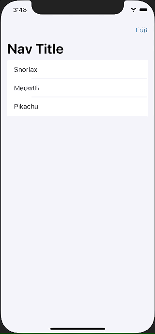

+++
title =  "SwiftUIでListをEditModeにして並び替える"
url = "2021-04-02"
date = "2021-04-02"
description = "SwiftUIでListをEditModeにして並び替える"
tags = ["iOS", "Swift", "SwiftUI"]
categories = ["iOS", "SwiftUI"]
archives = "2021/04"
+++

<br>

SwiftUIでListをEditModeにして並び替える方法です。
UITableViewのEditModeのようにして並び替えることができます。
Listの中にforを定義する必要があります。最初ハマりました。



<!-- Google Ads -->


<!-- Amazon Ads -->


<!--more-->

**ContentView.swift**

```swift
import SwiftUI

struct Pokemon: Identifiable {
    var id: Int
    let name: String
}

struct ContentView: View {
    @State var pokemons: [Pokemon] = [
        Pokemon(id: 143, name: "Snorlax"),
        Pokemon(id: 52, name: "Meowth"),
        Pokemon(id: 25, name: "Pikachu"),
    ]
    
    var body: some View {
        NavigationView {
            List {
                ForEach(pokemons) { pokemon in
                    Text(pokemon.name)
                }.onMove { (indexSet, index) in
                    self.pokemons.move(fromOffsets: indexSet, toOffset: index)
                }
            }
            .navigationBarTitle(Text("Nav Title"))
            .navigationBarItems(trailing: EditButton())
        }
    }
}

struct ContentView_Previews: PreviewProvider {
    static var previews: some View {
        ContentView()
    }
}
```


