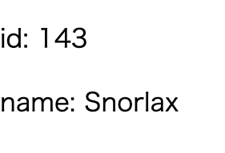

+++
title =  "Elmで型エイリアスを定義する"
url = "2021-04-04"
date = "2021-04-04"
description = "Elmで型エイリアスを定義する"
tags = ["Elm"]
categories = ["Elm"]
archives = "2021/04"
+++

<br>

Elmで型エイリアスを定義する方法です。
Pokemonという型エイリアスを定義して、その内容を表示しています。




<!-- Google Ads -->


<!-- Amazon Ads -->


<!--more-->

**Main.elm**

```elm
module Main exposing (main)

import Html exposing (..)
import Html.Attributes exposing (..)


type alias Model =
    Pokemon


type alias Pokemon =
    { id : Int
    , name : String
    }


initialModel : Model
initialModel =
    { id = 143, name = "Snorlax" }


view : Model -> Html msg
view model =
    div []
        [ p [] [ text ("id: " ++ String.fromInt model.id) ]
        , p [] [ text ("name: " ++ model.name) ]
        ]


main : Html msg
main =
    view initialModel
```


