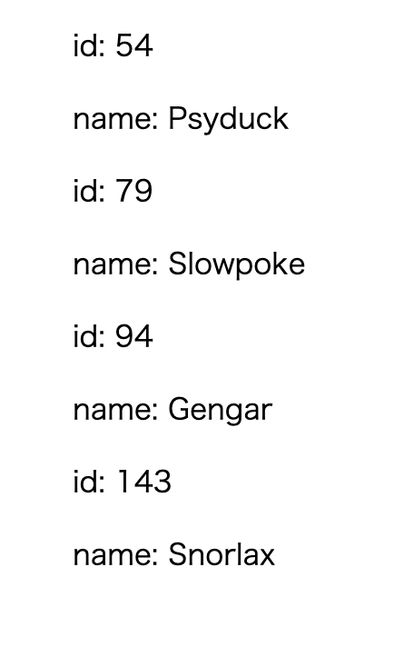

+++
title =  "Elmで型エイリアスが入った配列を繰り返し表示す"
url = "2021-04-05"
date = "2021-04-05"
description = "Elmで型エイリアスが入った配列を繰り返し表示する"
tags = ["Elm"]
categories = ["Elm"]
archives = "2021/04"
+++

<br>

Elmで型エイリアスが入った配列を繰り返し表示する方法です。
Pokemonという型エイリアスの配列の内容を繰り返して表示しています。




<!-- Google Ads -->


<!-- Amazon Ads -->


<!--more-->

**Main.elm**

```elm
module Main exposing (main)

import Html exposing (..)
import Html.Attributes exposing (..)


type alias Pokemon =
    { id : Int
    , name : String
    }


type alias Model =
    List Pokemon


initialModel : Model
initialModel =
    [ { id = 54, name = "Psyduck" }, { id = 79, name = "Slowpoke" }, { id = 94, name = "Gengar" }, { id = 143, name = "Snorlax" } ]


liComponent : Pokemon -> Html msg
liComponent pokemon =
    div []
        [ p [] [ text ("id: " ++ String.fromInt pokemon.id) ]
        , p [] [ text ("name: " ++ pokemon.name) ]
        ]


view : Model -> Html msg
view model =
    div []
        [ ul [] (List.map liComponent)
        ]


main : Html msg
main =
    view initialModel
```


