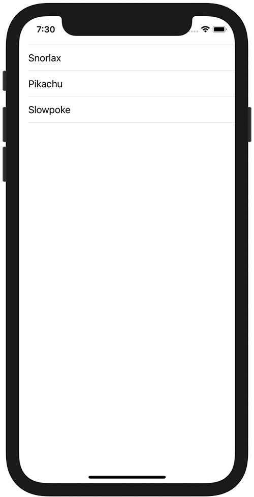

+++
title =  "SwiftUIのListでSpacerの部分にもタップ判定をつける"
url = "2021-04-07"
date = "2021-04-07"
description = "SwiftUIのListでSpacerの部分にもタップ判定をつける"
tags = ["Swift", "SwiftUI"]
categories = ["SwiftUI"]
archives = "2021/04"
+++

<br>

SwiftUIのListでSpacerの部分にもタップ判定をつける方法です。
`.contentShape(Rectangle())` を設定することでタップ範囲を広げています。



参考サイト
[SwiftUI pick a value from a list with ontap gesture](https://stackoverflow.com/questions/58500295/swiftui-pick-a-value-from-a-list-with-ontap-gesture)

<!-- Google Ads -->


<!-- Amazon Ads -->


<!--more-->

**ContentView.swift**

```swift
import SwiftUI

struct ContentView: View {
    let pokemons: [String] = ["Snorlax", "Pikachu", "Slowpoke"]
    var body: some View {
        List(pokemons, id: \.self) {pokemon in
            HStack {
                Text(pokemon)
                Spacer()
            }
            .contentShape(Rectangle())
            .onTapGesture {
                print(pokemon)
            }
        }
    }
}

struct ContentView_Previews: PreviewProvider {
    static var previews: some View {
        ContentView()
    }
}
```


