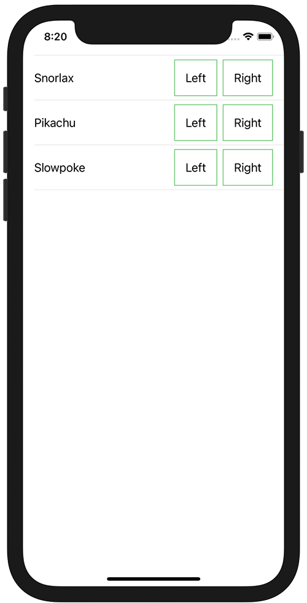

+++
title =  "SwiftUIのListの中にボタンを複数設置する"
url = "2021-04-08"
date = "2021-04-08"
description = "SwiftUIのListの中にボタンを複数設置する"
tags = ["Swift", "SwiftUI"]
categories = ["SwiftUI"]
archives = "2021/04"
+++

<br>

SwiftUIのListの中にボタンを複数設置する方法です。
`buttonStyle(PlainButtonStyle())` を設定することできました。



参考サイト
[SwiftUI pick a value from a list with ontap gesture](https://stackoverflow.com/questions/58500295/swiftui-pick-a-value-from-a-list-with-ontap-gesture)

<!-- Google Ads -->


<!-- Amazon Ads -->


<!--more-->

**ContentView.swift**

```swift
import SwiftUI

struct ContentView: View {
    let pokemons: [String] = ["Snorlax", "Pikachu", "Slowpoke"]
    var body: some View {
        List(pokemons, id: \.self) {pokemon in
            HStack(alignment: .center) {
                Text(pokemon)
                
                Spacer()
                
                Button {
                    print("\(pokemon) Left")
                } label: {
                    Text("Left")
                        .padding()
                        .border(Color.green)
                }
                .buttonStyle(PlainButtonStyle())

                Button {
                    print("\(pokemon) Right")
                } label: {
                    Text("Right")
                        .padding()
                        .border(Color.green)
                }
                .buttonStyle(PlainButtonStyle())
            }
            .contentShape(Rectangle())
            .onTapGesture {
                print("\(pokemon) Cell")
            }
        }
    }
}

struct ContentView_Previews: PreviewProvider {
    static var previews: some View {
        ContentView()
    }
}
```


