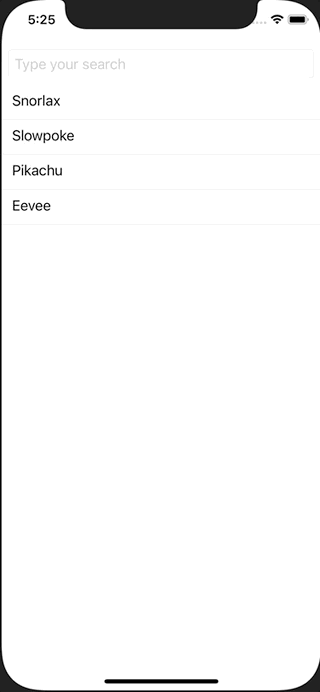

+++
title =  "SwiftUIでSearchBar(TextField)を使って検索する"
url = "2021-05-01"
date = "2021-05-01"
description = "SwiftUIでSearchBar(TextField)を使って検索する"
tags = ["Swift", "SwiftUI"]
categories = ["SwiftUI"]
archives = "2021/05"
+++

<br>

SwiftUIでSearchBar(TextField)を使って検索する方法です。
TextFiled に文字を入力するとポケモンを検索します。



<!-- Google Ads -->


<!-- Amazon Ads -->


<!--more-->

**ContentView.swift**

```swift
import SwiftUI

struct ContentView: View {
    let pokemons: [String] = ["Snorlax", "Slowpoke", "Pikachu", "Eevee"]
    @State var text: String = ""
    var filterdPokemons: [String] {
        if text.isEmpty {
            return pokemons
        } else {
            return pokemons.filter {$0.uppercased().contains(text.uppercased())}
        }
    }
    var body: some View {
        ScrollView {
            LazyVStack{
                TextField("Type your search",text: $text)
                    .padding(8)
                    .textFieldStyle(RoundedBorderTextFieldStyle())
                ForEach(filterdPokemons, id: \.self) { pokemon in
                    VStack(alignment: .leading) {
                        Text(pokemon)
                            .padding(.leading, 12)
                        Divider()
                    }
                }
            }
        }
    }
}

struct ContentView_Previews: PreviewProvider {
    static var previews: some View {
        ContentView()
    }
}
```


