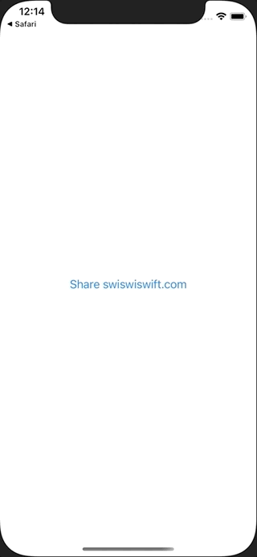

+++
title =  "SwiftUIでUIActivityViewControllerを表示する"
url = "2021-05-05"
date = "2021-05-05"
description = "SwiftUIでUIActivityViewControllerを表示する"
tags = ["Swift", "SwiftUI"]
categories = ["SwiftUI"]
archives = "2021/05"
+++

<br>

SwiftUIでUIActivityViewControllerを表示する方法です。
ボタンを押すと URL を共有するシートを表示します。



参考: [Showing 'UIActivityViewController' in SwiftUI](https://stackoverflow.com/questions/56533564/showing-uiactivityviewcontroller-in-swiftui)


<!-- Google Ads -->


<!-- Amazon Ads -->


<!--more-->

**ActivityViewController.swift**

```swift
import SwiftUI

struct ActivityViewController: UIViewControllerRepresentable {
    var activityItems: [Any]
    var applicationActivities: [UIActivity]? = nil
    
    func makeUIViewController(context: UIViewControllerRepresentableContext<ActivityViewController>) -> UIActivityViewController {
        let controller = UIActivityViewController(activityItems: activityItems, applicationActivities: applicationActivities)
        return controller
    }
    
    func updateUIViewController(_ uiViewController: UIActivityViewController, context: UIViewControllerRepresentableContext<ActivityViewController>) {}
}
```


**ContentView.swift**

```swift
import SwiftUI

struct ContentView: View {
    @State private var showingActivityIndicator: Bool = false

    var body: some View {
        Button("Share swiswiswift.com") {
            showingActivityIndicator = true
        }
        .sheet(isPresented: $showingActivityIndicator, content: {
            ActivityViewController(activityItems: [URL(string: "https://swiswiswift.com")!])
        })
    }
}

struct ContentView_Previews: PreviewProvider {
    static var previews: some View {
        ContentView()
    }
}
```


